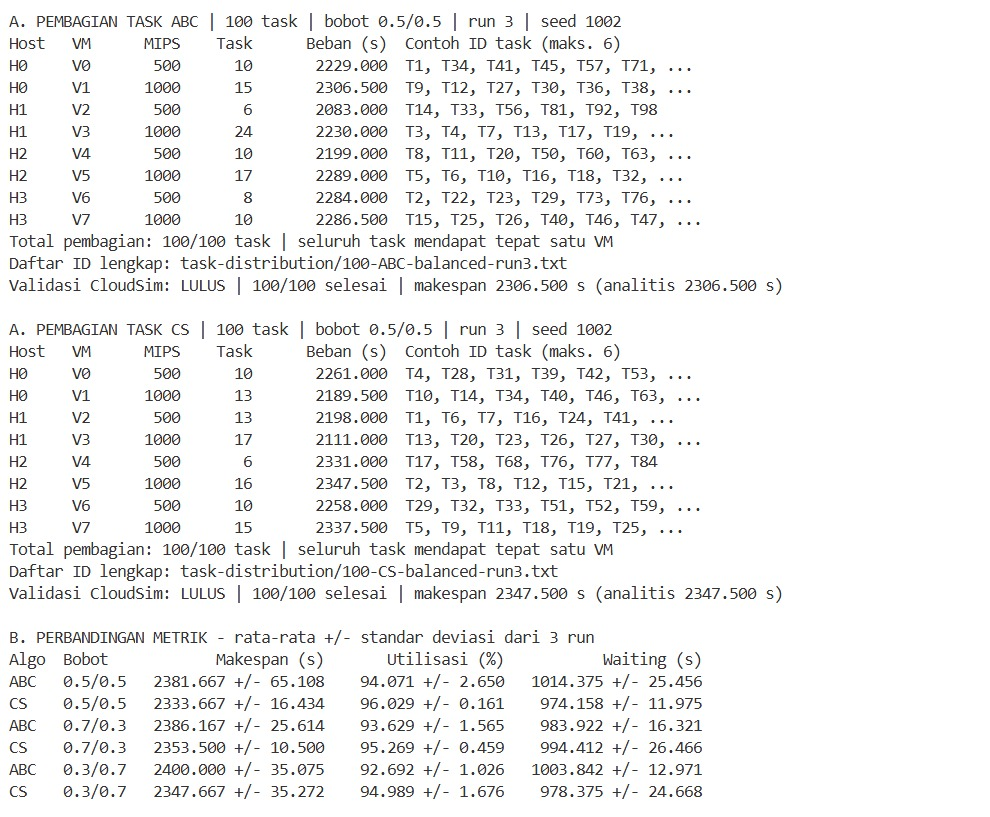
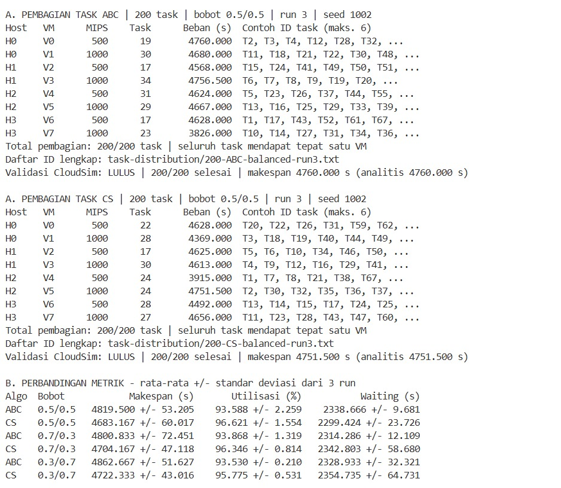
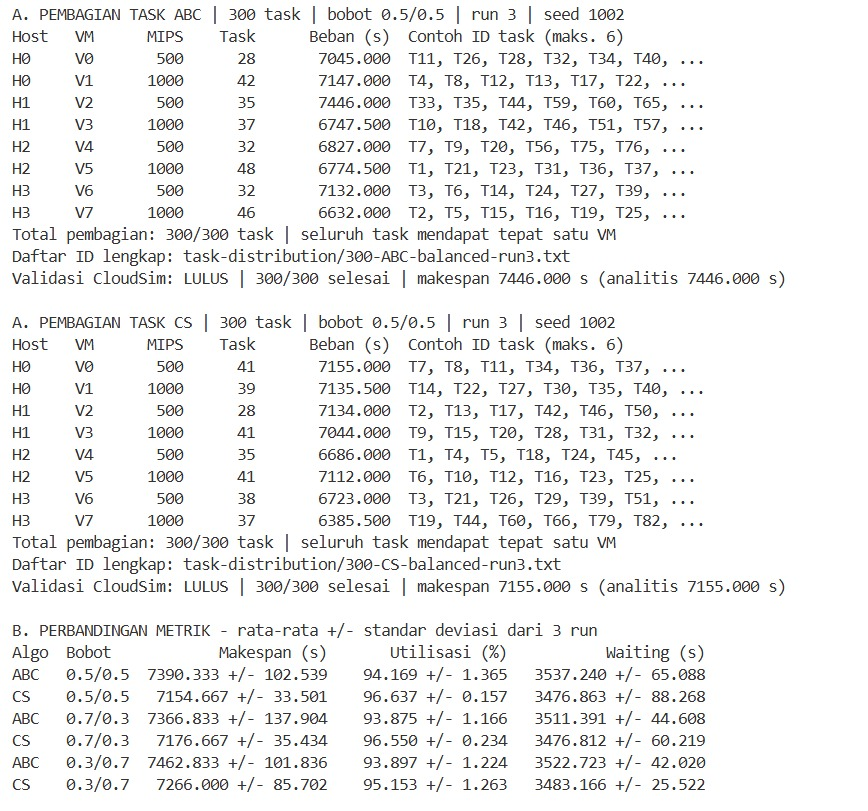
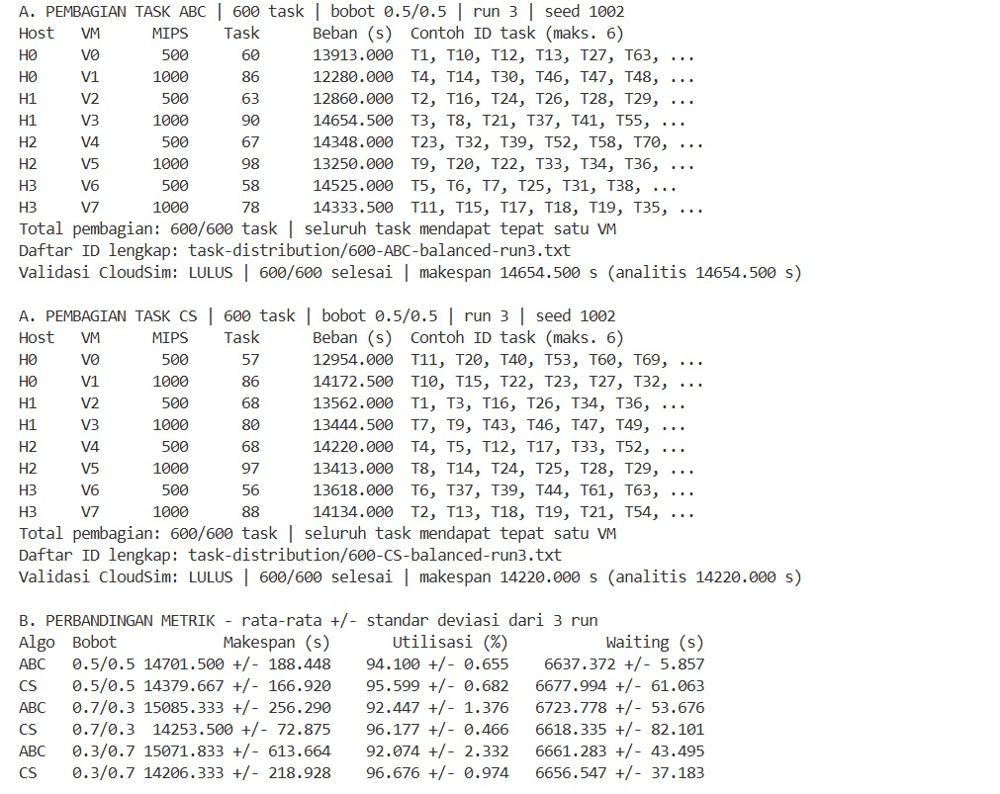
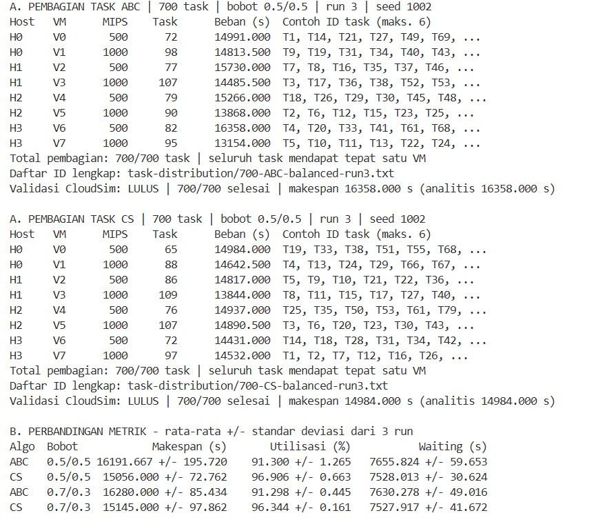
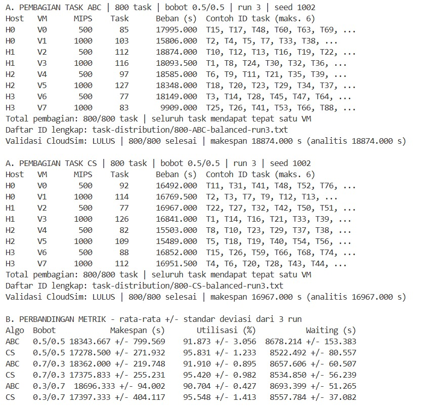
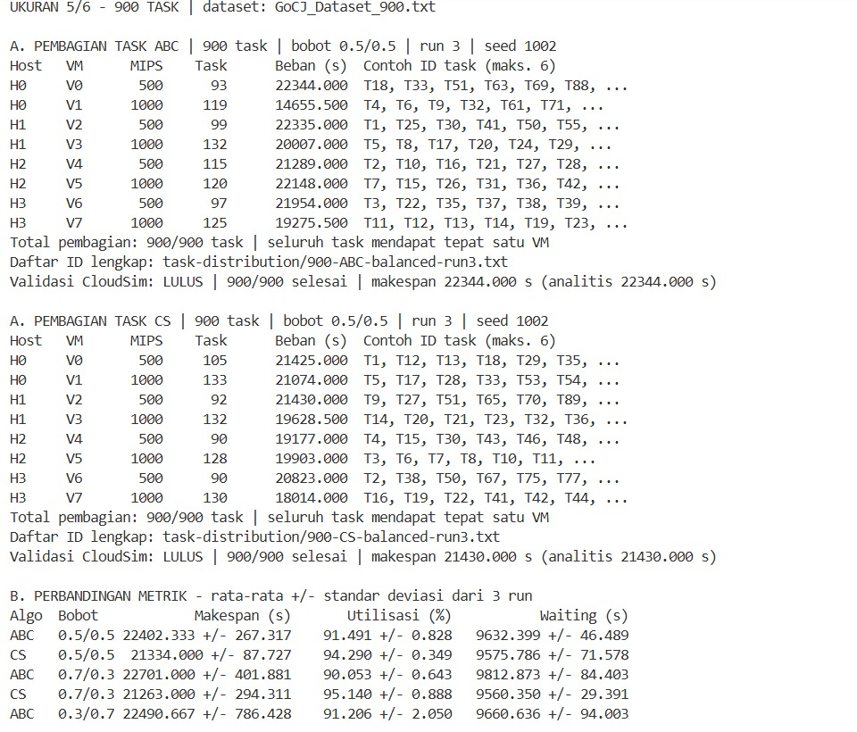
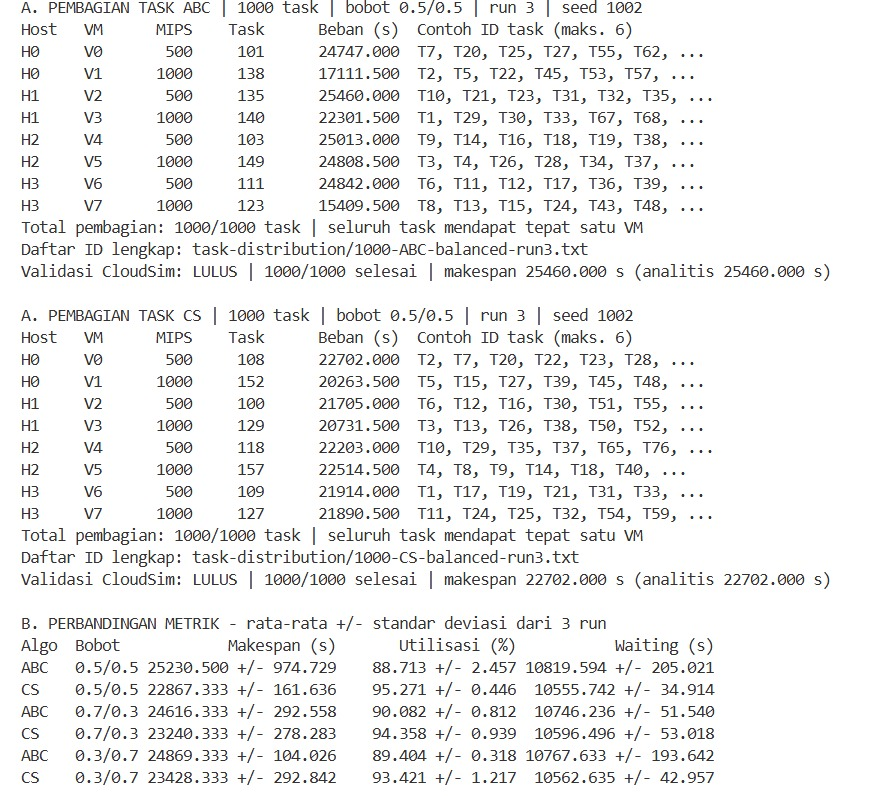

# Implementasi Metaheuristik untuk Task Scheduling Cloud

Paket tugas Kelompok 5 khusus **Artificial Bee Colony (ABC)** dan **Cuckoo Search (CS)**, dipisahkan dari eksperimen sebelumnya. Source paket ini hanya memuat dua metaheuristik mandiri; inisialisasi ABC menggunakan populasi acak. Tidak ada Round Robin, RR-ABC, atau GA-GWO dalam paket ini.

## Tujuan

Mengimplementasikan dan membandingkan ABC serta CS untuk memetakan task ke VM heterogen. Optimasi mencari makespan rendah dan utilisasi tinggi. Waktu tunggu dilaporkan sebagai metrik tambahan dan tidak dimasukkan langsung ke fungsi fitness.

## Arsitektur dan alur sistem

```text
Dataset GoCJ (panjang task dalam MI)
                  |
                  v
        ABC / Cuckoo Search
     pencarian pemetaan task -> VM
                  |
                  v
       Evaluasi fitness dan metrik
                  |
                  v
 Validasi CloudSim pada run yang dipilih
                  |
                  v
     CSV hasil + ringkasan + log

Datacenter DC_0
+-- Host #0
|   +-- VM #0:  500 MIPS,  512 MB RAM
|   +-- VM #1: 1000 MIPS, 1024 MB RAM
+-- Host #1
|   +-- VM #2:  500 MIPS,  512 MB RAM
|   +-- VM #3: 1000 MIPS, 1024 MB RAM
+-- Host #2
|   +-- VM #4:  500 MIPS,  512 MB RAM
|   +-- VM #5: 1000 MIPS, 1024 MB RAM
+-- Host #3
    +-- VM #6:  500 MIPS,  512 MB RAM
    +-- VM #7: 1000 MIPS, 1024 MB RAM
```

Pencarian solusi dilakukan oleh kode algoritma Java, kemudian pemetaan terpilih dikirim ke CloudSim untuk validasi. Host dan VM di sini merupakan entitas simulasi.

## Menjalankan

Dari PowerShell di root repositori:

```powershell
.\run-metaheuristik.ps1
```

Script memakai JDK 21, Maven, dan dependensi CloudSim 7.0.1 yang sudah tersedia di `.tools` pada workspace ini. Script melakukan clean compile sebelum menjalankan simulasi. Hasil run sebelumnya pada folder paket ini akan ditimpa.

Untuk mesin lain, siapkan JDK 21 dan Maven serta instal dependensi CloudSim 7.0.1 ke repositori Maven lokal. Pertahankan folder dataset GoCJ di sebelah folder paket ini, lalu dari folder paket jalankan:

```powershell
mvn compile exec:java '-Dexec.mainClass=soka.Main'
```

Untuk menjalankan dari PowerShell apabila eksekusi script diblokir:

```powershell
powershell -ExecutionPolicy Bypass -File .\run-metaheuristik.ps1
```

Sebelum menjalankan, pastikan tersedia folder `.tools/jdk-21.0.12.1+1`, `.tools/apache-maven-3.9.9`, `.tools/m2`, file `.vscode/maven-settings.xml`, dan sepuluh file dataset yang diperlukan. Script menggunakan lokasi tersebut secara eksplisit. Perintah Maven manual tidak otomatis menyimpan log melalui `Tee-Object`; penyimpanan `simulation-output.txt` dilakukan oleh script PowerShell.

## Konfigurasi eksperimen

- Simulasi CloudSim: 1 datacenter, 4 host, 2 VM per host (8 VM).
- Setiap host: 2 PE x 1000 MIPS, RAM 16384 MB. VM per host: 500 MIPS/512 MB dan 1000 MIPS/1024 MB.
- Dataset: `../GoCJ Google Cloud Jobs Dataset/GoCJ_Dataset_<jumlah>.txt`, 100 hingga 1000 task dengan kenaikan 100.
- Task independen, tersedia sejak awal, non-preemptive, antrean serial per VM (SpaceShared).
- Populasi 30, iterasi 100; ABC limit 20; CS probabilitas abandonment 0.25.
- Tiga pasangan bobot (makespan, utilisasi): (0.5, 0.5), (0.7, 0.3), (0.3, 0.7).
- Tiga pengulangan dengan seed 1000, 1001, 1002.
- Total 180 run: 10 ukuran x 2 algoritma x 3 bobot x 3 pengulangan; 60 ringkasan.

## Cara kerja implementasi

Solusi adalah array indeks VM: elemen ke-i menentukan VM untuk task ke-i. Kandidat dievaluasi memakai fungsi tujuan yang diminimalkan:

```text
lowerBound = total MI / total MIPS
fitness = w1 * (makespan / lowerBound) - w2 * (utilisasi / 100)
```

ABC mengembangkan solusi melalui employed bees, pemilihan onlooker berdasarkan kualitas, dan scout yang mengganti solusi stagnan. CS membentuk kandidat menggunakan langkah Levy yang didiskretisasi ke indeks VM, seleksi kandidat, serta pembaruan sarang terburuk. Keduanya mempertahankan solusi terbaik yang tercatat pada akhir iterasi. Ini adaptasi diskret untuk penjadwalan task.

Makespan adalah maksimum total durasi task pada satu VM. Utilisasi adalah total waktu sibuk seluruh VM dibagi makespan x jumlah VM. Waiting time dihitung dari antrean task menurut urutan dataset. Metrik ini adalah hasil model simulasi, bukan pengukuran CPU mesin nyata. Populasi dan iterasi yang sama tidak menjamin jumlah evaluasi fitness kedua algoritma sama.

### Representasi solusi

Contoh untuk enam task dan delapan VM:

```text
Task    : 0  1  2  3  4  5
Mapping : 2  0  3  1  2  3
```

Task 0 dan 4 diproses VM 2, task 1 diproses VM 0, dan seterusnya. Contoh ini hanya memakai sebagian dari delapan VM. Setiap indeks mapping berada pada rentang 0 sampai 7. Algoritma mengubah penempatan task; urutan task pada VM mengikuti urutan dataset.

### Tahapan Artificial Bee Colony

1. Bangkitkan 30 food source berupa pemetaan acak, lalu evaluasi fitness.
2. **Employed bees:** bentuk kandidat dengan memilih food source pembanding. Lakukan `max(1, jumlahTask / 10)` percobaan perubahan posisi acak. Kandidat diterima jika fitness lebih kecil.
3. **Onlooker bees:** pilih food source dengan bobot `fitnessTerburuk - fitnessSaatIni + 1e-9`, kemudian lakukan perbaikan kandidat.
4. **Scout bees:** ganti food source dengan pemetaan acak jika penghitung kegagalannya melebihi limit 20.
5. Perbarui arsip solusi terbaik pada akhir iterasi. Ulangi hingga 100 iterasi dan kembalikan arsip tersebut.

Posisi perubahan dipilih dengan pengembalian, sehingga satu task dapat dipilih lebih dari sekali. Operasi `Math.floorMod` menjaga hasil pemetaan tetap dalam rentang indeks VM.

### Tahapan Cuckoo Search

1. Bangkitkan 30 sarang berisi pemetaan acak dan evaluasi fitness.
2. Bentuk kandidat melalui langkah Levy dengan beta 1.5 dan sigma 0.6966; langkah dibulatkan untuk penjadwalan diskret.
3. Lakukan `max(1, jumlahTask / 10)` percobaan perubahan posisi acak, lalu bandingkan kandidat dengan sarang acak. Ganti sarang jika kandidat lebih baik.
4. Lakukan `round(pa * populasi)` pembaruan dengan `pa = 0.25`, yaitu 8 pembaruan. Pada setiap pembaruan, pilih kembali sarang terburuk saat itu dan ubah berdasarkan selisih dua sarang acak. Karena pemilihan diulang, sarang yang sama dapat terpilih lagi.
5. Perbarui arsip solusi terbaik pada akhir iterasi. Ulangi hingga 100 iterasi dan kembalikan arsip tersebut.

### Rumus metrik

Untuk panjang task `MI[i]` dan kapasitas VM `MIPS[j]`:

```text
durasiTask[i] = MI[i] / MIPS[mapping[i]]
busy[j]      = jumlah durasi task yang ditempatkan pada VM j
makespan     = maksimum busy[j]
utilisasi    = jumlah busy[j] / (makespan * jumlahVM) * 100%
waiting[i]   = jumlah durasi task sebelumnya pada VM yang sama
avgWaiting   = jumlah waiting[i] / jumlahTask
```

Nilai fitness yang lebih kecil menunjukkan solusi lebih baik untuk pasangan bobot yang sama. Fitness dapat bernilai negatif karena komponen utilisasi dikurangkan; nilai negatif bukan kegagalan program. Waktu dalam tabel merupakan detik model simulasi, bukan lama algoritma dijalankan pada laptop.

## Hasil terverifikasi

Eksekusi ulang pada 16 November 2026 dengan 4 host dan 8 VM berhasil menghasilkan 180 run dan 60 ringkasan. Hasil 4 VM sebelumnya disimpan di folder `archive/`. Validasi CloudSim sebanyak 20 kali (run ketiga, bobot seimbang, setiap ukuran dan algoritma) memeriksa jumlah task selesai dan kecocokan makespan analitis dengan toleransi 0.01 detik. Ketidaksesuaian menghentikan program. Utilisasi dan waiting time dihitung secara analitis.

Contoh hasil 1000 task, bobot 0.5/0.5, rata-rata +/- standar deviasi sampel dari 3 run:

| Algoritma | Makespan (detik) | Utilisasi (%) | Waiting time (detik) |
|---|---:|---:|---:|
| ABC | 25230.500 +/- 974.729 | 88.713 +/- 2.457 | 10819.594 +/- 205.021 |
| CS | 22867.333 +/- 161.636 | 95.271 +/- 0.446 | 10555.742 +/- 34.914 |

Pada konfigurasi contoh ini CS menghasilkan makespan rata-rata lebih rendah. Tiga pengulangan belum cukup untuk menyatakan keunggulan universal. Hasil ini memakai 8 VM; jangan dicampur dengan hasil arsip eksperimen bertopologi berbeda.

## Membaca keluaran

| File | Isi | Penggunaan |
|---|---|---|
| [results.csv](results.csv) | 180 baris hasil individual | Membandingkan variasi antar-run |
| [summary.csv](summary.csv) | 60 baris ringkasan | Membandingkan rata-rata dan standar deviasi |
| [simulation-output.txt](simulation-output.txt) | Log terminal dan validasi | Bukti eksekusi dan topologi |

Kolom `results.csv` adalah `tasks`, `algo`, `w1`, `w2`, `run`, `makespan`, `util`, `waiting`, dan `fitness`. Kolom waktu memakai detik; `util` memakai persen.

Pada `summary.csv`, akhiran `_mean` menunjukkan rata-rata dan `_std` menunjukkan standar deviasi sampel dengan penyebut `n - 1`. Awalan `mk`, `util`, `wait`, dan `fit` masing-masing berarti makespan, utilisasi, waktu tunggu, dan fitness. Kolom `runs` menunjukkan jumlah pengulangan.

## Mengubah parameter

Pengaturan eksperimen berada di [Main.java](src/main/java/soka/Main.java):

```java
double[][] W = {{0.5, 0.5}, {0.7, 0.3}, {0.3, 0.7}};
int RUNS = 3;

new ABC(w[0], w[1], 30, 100, 20);
new CuckooSearch(w[0], w[1], 30, 100, 0.25);
```

Rentang dataset diatur oleh perulangan `tasks = 100` hingga `tasks <= 1000` dengan kenaikan 100. Seed diatur melalui `new Random(1000 + r)`. Topologi dan kapasitas VM diatur di [CloudEnv.java](src/main/java/soka/CloudEnv.java), sedangkan rumus metrik berada di [Metrics.java](src/main/java/soka/Metrics.java).

Jika jumlah pengulangan atau urutan bobot diubah, sesuaikan pula tulisan log tentang run ketiga dan bobot seimbang. Saat ini validasi menggunakan mapping run terakhir untuk pasangan bobot pertama (`W[0]`). Simpan hasil lama sebelum menjalankan konfigurasi baru.

## Kendala yang mungkin muncul

| Pesan atau gejala | Pemeriksaan |
|---|---|
| Java atau Maven tidak ditemukan | Periksa lokasi `.tools` yang ditentukan script atau gunakan instalasi lokal melalui perintah Maven manual |
| Dependensi CloudSim tidak ditemukan | Pastikan artefak CloudSim 7.0.1 tersedia di repositori Maven yang digunakan |
| File dataset tidak ditemukan | Jalankan Maven dari folder paket; pastikan folder GoCJ berada di direktori induknya |
| `Jumlah dataset tidak sesuai` | Pastikan jumlah baris berisi angka sesuai ukuran pada nama file |
| `Validasi CloudSim gagal` | Periksa jumlah task selesai dan perbandingan makespan di log; jangan gunakan run yang gagal sebagai hasil akhir |

## Batasan eksperimen

Eksperimen menggunakan task statis dan independen, tanpa dependensi antar-task, kedatangan dinamis, atau pengukuran jaringan nyata. Metrik utilisasi dihitung berdasarkan waktu sibuk VM, bukan persentase CPU hardware. Evaluasi tidak mengukur waktu komputasi optimizer atau membuktikan solusi optimum global. Seed yang sama membantu pengulangan eksperimen, tetapi kedua algoritma tetap menggunakan urutan operasi acak yang berbeda.

## Berkas

- `src/main/java/soka/Main.java`: eksperimen, CSV, tabel terminal, validasi.
- `src/main/java/soka/algo/ABC.java`: metaheuristik ABC mandiri.
- `src/main/java/soka/algo/CuckooSearch.java`: metaheuristik CS mandiri.
- `src/main/java/soka/CloudEnv.java`: topologi dan simulasi CloudSim.
- `src/main/java/soka/Metrics.java`: fungsi tujuan dan metrik.
- `results.csv`: hasil seluruh run.
- `summary.csv`: rata-rata dan standar deviasi sampel.
- `simulation-output.txt`: log eksekusi dan validasi CloudSim.

Paket tetap memakai dataset GoCJ bersama di root repositori. Untuk mengumpulkan atau memindahkan tugas, sertakan folder dataset dan sesuaikan lokasi tool pada script bila diperlukan.


## Dokumentasi hasil simulasi 100-1000 task

Dokumentasi berikut berasal dari screenshot eksekusi ABC dan Cuckoo Search. Setiap gambar menampilkan pembagian task ke 4 host dan 8 VM, validasi CloudSim, serta perbandingan metrik.

Pembagian per VM memakai **bobot 0.5/0.5, run ketiga, seed 1002**. Tabel metrik di bagian bawah gambar menunjukkan **rata-rata +/- standar deviasi tiga run** untuk masing-masing pasangan bobot. Karena itu, makespan pada satu pemetaan dapat berbeda dari makespan rata-rata.

### 1. Simulasi 100 task



**Gambar 1.** Hasil penjadwalan 100 task menggunakan ABC dan Cuckoo Search. Tabel menunjukkan jumlah task, beban, dan contoh ID task pada setiap VM. Kedua algoritma menyelesaikan **100/100 task** dan lolos validasi CloudSim. Tabel bagian bawah membandingkan makespan, utilisasi, dan waiting time.

### 2. Simulasi 200 task



**Gambar 2.** Hasil penjadwalan 200 task menggunakan ABC dan Cuckoo Search. Tabel menunjukkan jumlah task, beban, dan contoh ID task pada setiap VM. Kedua algoritma menyelesaikan **200/200 task** dan lolos validasi CloudSim. Tabel bagian bawah membandingkan makespan, utilisasi, dan waiting time.

### 3. Simulasi 300 task



**Gambar 3.** Hasil penjadwalan 300 task menggunakan ABC dan Cuckoo Search. Tabel menunjukkan jumlah task, beban, dan contoh ID task pada setiap VM. Kedua algoritma menyelesaikan **300/300 task** dan lolos validasi CloudSim. Tabel bagian bawah membandingkan makespan, utilisasi, dan waiting time.

### 4. Simulasi 400 task


**Gambar 4.** Hasil penjadwalan 400 task menggunakan ABC dan Cuckoo Search. Tabel menunjukkan jumlah task, beban, dan contoh ID task pada setiap VM. Kedua algoritma menyelesaikan **400/400 task** dan lolos validasi CloudSim. Tabel bagian bawah membandingkan makespan, utilisasi, dan waiting time.

### 5. Simulasi 500 task


**Gambar 5.** Hasil penjadwalan 500 task menggunakan ABC dan Cuckoo Search. Tabel menunjukkan jumlah task, beban, dan contoh ID task pada setiap VM. Kedua algoritma menyelesaikan **500/500 task** dan lolos validasi CloudSim. Tabel bagian bawah membandingkan makespan, utilisasi, dan waiting time.

### 6. Simulasi 600 task



**Gambar 6.** Hasil penjadwalan 600 task menggunakan ABC dan Cuckoo Search pada 4 host dan 8 VM. Pembagian task menggunakan bobot 0.5/0.5, run ketiga, seed 1002. Kedua algoritma menyelesaikan **600/600 task** dan lolos validasi CloudSim. Tabel bagian bawah menampilkan perbandingan metrik dari tiga run.

### 7. Simulasi 700 task



**Gambar 7.** Hasil penjadwalan 700 task menggunakan ABC dan Cuckoo Search pada 4 host dan 8 VM. Pembagian task menggunakan bobot 0.5/0.5, run ketiga, seed 1002. Kedua algoritma menyelesaikan **700/700 task** dan lolos validasi CloudSim. Tabel bagian bawah menampilkan perbandingan metrik dari tiga run.

Sebagian baris akhir tabel metrik tidak terlihat pada screenshot. Data lengkap tersedia pada file summary.csv hasil eksperimen lanjutan.

### 8. Simulasi 800 task



**Gambar 8.** Hasil penjadwalan 800 task menggunakan ABC dan Cuckoo Search pada 4 host dan 8 VM. Pembagian task menggunakan bobot 0.5/0.5, run ketiga, seed 1002. Kedua algoritma menyelesaikan **800/800 task** dan lolos validasi CloudSim. Tabel bagian bawah menampilkan perbandingan metrik dari tiga run.

### 9. Simulasi 900 task



**Gambar 9.** Hasil penjadwalan 900 task menggunakan ABC dan Cuckoo Search pada 4 host dan 8 VM. Pembagian task menggunakan bobot 0.5/0.5, run ketiga, seed 1002. Kedua algoritma menyelesaikan **900/900 task** dan lolos validasi CloudSim. Tabel bagian bawah menampilkan perbandingan metrik dari tiga run.

Sebagian baris akhir tabel metrik tidak terlihat pada screenshot. Data lengkap tersedia pada file summary.csv hasil eksperimen lanjutan.

### 10. Simulasi 1000 task



**Gambar 10.** Hasil penjadwalan 1000 task menggunakan ABC dan Cuckoo Search pada 4 host dan 8 VM. Pembagian task menggunakan bobot 0.5/0.5, run ketiga, seed 1002. Kedua algoritma menyelesaikan **1000/1000 task** dan lolos validasi CloudSim. Tabel bagian bawah menampilkan perbandingan metrik dari tiga run.

