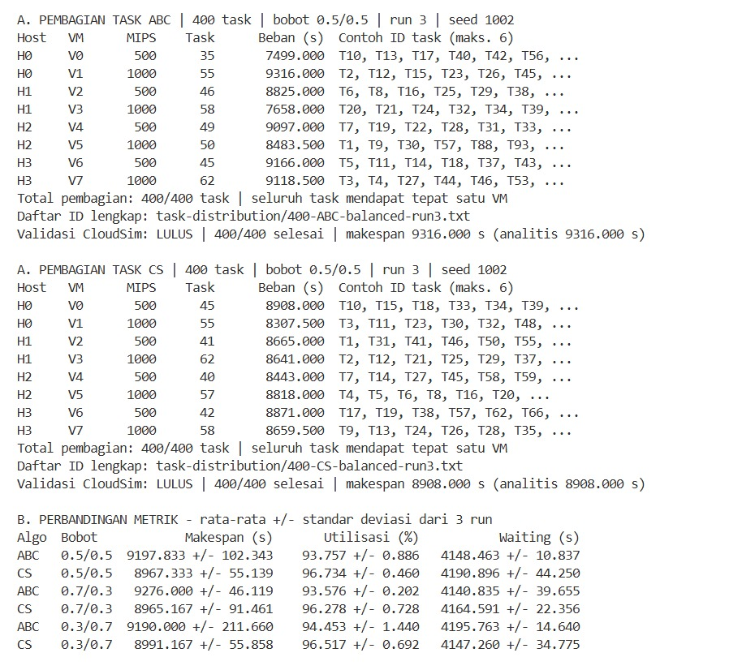
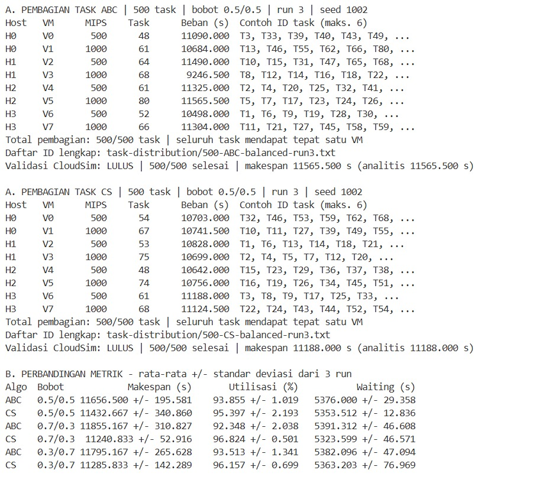

# Task Scheduling Cloud dengan Metaheuristik

Implementasi **Artificial Bee Colony (ABC)** dan **Cuckoo Search (CS)** untuk penjadwalan task menggunakan CloudSim 7.0.1. Eksperimen aktif memakai **100, 200, 300, 400, dan 500 task**, dengan **1 datacenter, 4 host, dan 8 VM**.

Kode utama: [Main.java](src/main/java/soka/Main.java). Kode algoritma: [ABC.java](src/main/java/soka/algo/ABC.java) dan [CuckooSearch.java](src/main/java/soka/algo/CuckooSearch.java).

## Urutan panduan

1. [Tujuan](#1-tujuan)
2. [Arsitektur cloud](#2-arsitektur-cloud)
3. [Konfigurasi eksperimen](#3-konfigurasi-eksperimen)
4. [Cara kerja algoritma dan metrik](#4-cara-kerja-algoritma-dan-metrik)
5. [Struktur kode](#5-struktur-kode)
6. [Persiapan lingkungan dan dataset](#6-persiapan-lingkungan-dan-dataset)
7. [Menjalankan simulasi](#7-menjalankan-simulasi)
8. [Membaca output dan pembagian task](#8-membaca-output-dan-pembagian-task)
9. [Memeriksa file hasil dan validasi](#9-memeriksa-file-hasil-dan-validasi)
10. [Hasil eksperimen 100-500 task](#10-hasil-eksperimen-100-500-task)
11. [Dokumentasi hasil simulasi 100-500 task](#11-dokumentasi-hasil-simulasi-100-500-task)
12. [Penanganan kendala](#12-penanganan-kendala)

## 1. Tujuan

Mencari pemetaan task ke VM heterogen yang menghasilkan makespan rendah dan utilisasi tinggi. Waktu tunggu dilaporkan sebagai metrik tambahan. Setiap task ditempatkan pada satu VM; task pada VM yang sama diproses berurutan mengikuti urutan dataset.

## 2. Arsitektur cloud

```text
Datacenter DC_0
+-- Host H0 -> VM V0 (500 MIPS) dan V1 (1000 MIPS)
+-- Host H1 -> VM V2 (500 MIPS) dan V3 (1000 MIPS)
+-- Host H2 -> VM V4 (500 MIPS) dan V5 (1000 MIPS)
+-- Host H3 -> VM V6 (500 MIPS) dan V7 (1000 MIPS)
```

Setiap host mempunyai 2 PE x 1000 MIPS dan RAM 16384 MB. VM 500 MIPS mempunyai RAM 512 MB; VM 1000 MIPS mempunyai RAM 1024 MB. Host dan VM merupakan entitas simulasi CloudSim.

Alur program: baca dataset GoCJ -> cari pemetaan dengan ABC/CS -> hitung metrik -> validasi pemetaan terpilih di CloudSim -> tampilkan pembagian dan simpan hasil.

### Visualisasi alur eksperimen

Diagram berikut merangkum urutan simulasi. **ABC dan CS dijalankan sebagai dua algoritma mandiri** dengan dataset dan konfigurasi VM yang sama.

```mermaid
flowchart TD
    START([Mulai eksperimen]) --> CONFIG["1. Siapkan konfigurasi cloud<br/>1 datacenter - 4 host - 8 VM"]
    CONFIG --> DATA["2. Baca dataset GoCJ<br/>100 ? 200 ? 300 ? 400 ? 500 task"]
    DATA --> SETUP["3. Untuk setiap ukuran dataset<br/>Uji bobot 0.5/0.5, 0.7/0.3, 0.3/0.7"]
    SETUP --> ABC["4. Jalankan Artificial Bee Colony<br/>3 run - seed 1000, 1001, 1002"]
    ABC --> ABCMAP["Pemetaan ABC: task ? VM ? host<br/>Hitung metrik dan simpan penempatan"]
    ABCMAP --> ABCVAL["Validasi ABC di CloudSim<br/>Hanya bobot 0.5/0.5, run ketiga"]
    ABCVAL --> CS["5. Jalankan Cuckoo Search<br/>3 run - seed 1000, 1001, 1002"]
    CS --> CSMAP["Pemetaan CS: task ? VM ? host<br/>Hitung metrik dan simpan penempatan"]
    CSMAP --> CSVAL["Validasi CS di CloudSim<br/>Hanya bobot 0.5/0.5, run ketiga"]
    CSVAL --> REPEAT["6. Lanjutkan bobot dan ukuran berikutnya<br/>Urutan ukuran: 100, 200, 300, 400, 500"]
    REPEAT --> OUTPUT["7. Bandingkan ABC dan CS<br/>Makespan - Utilisasi - Waiting time"]
    OUTPUT --> FILES["8. Simpan hasil dan dokumentasi<br/>CSV - pembagian per VM - log - screenshot"]
    FILES --> END([Selesai: 90 run - 30 ringkasan - 10 validasi])

    classDef startEnd fill:#0f172a,color:#ffffff,stroke:#0f172a;
    classDef setup fill:#e0f2fe,color:#0c4a6e,stroke:#0284c7;
    classDef abc fill:#dcfce7,color:#14532d,stroke:#16a34a;
    classDef cs fill:#fef3c7,color:#78350f,stroke:#d97706;
    classDef output fill:#ede9fe,color:#4c1d95,stroke:#7c3aed;
    class START,END startEnd;
    class CONFIG,DATA,SETUP setup;
    class ABC,ABCMAP,ABCVAL abc;
    class CS,CSMAP,CSVAL cs;
    class REPEAT,OUTPUT,FILES output;
```



**Cara membaca:** untuk setiap ukuran task, program menguji tiga bobot. Pada setiap bobot, ABC dijalankan tiga kali, dilanjutkan CS tiga kali. Setelah itu program melanjutkan bobot berikutnya, lalu ukuran dataset berikutnya. Kotak validasi hanya dijalankan untuk pemetaan run ketiga pada bobot seimbang; tidak ada validasi CloudSim tambahan pada bobot lain. Setiap algoritma menggunakan populasi 30 dan 100 iterasi.

Penjelasan tahap demi tahap tersedia di [Alur eksperimen simulasi](docs/ALUR-EKSPERIMEN.md).

## 3. Konfigurasi eksperimen

| Parameter | Nilai |
|---|---|
| Algoritma | ABC dan Cuckoo Search |
| Ukuran dataset | 100, 200, 300, 400, 500 task |
| Model task | Statis, independen, non-preemptive |
| Penjadwalan pada VM | SpaceShared, antrean serial |
| Populasi / iterasi | 30 / 100 |
| Limit ABC | 20; scout aktif ketika trial > limit |
| Parameter CS | pa = 0.25; beta = 1.5; sigma = 0.6966 |
| Bobot makespan / utilisasi | 0.5/0.5, 0.7/0.3, 0.3/0.7 |
| Pengulangan | 3; seed 1000, 1001, 1002 |
| Total run | 5 ukuran x 2 algoritma x 3 bobot x 3 run = 90 |
| Ringkasan / validasi | 30 ringkasan / 10 validasi CloudSim |

## 4. Cara kerja algoritma dan metrik

Solusi berupa array indeks VM, satu elemen untuk setiap task. Contoh `mapping = [2, 0, 3]` berarti T1 masuk V2, T2 masuk V0, dan T3 masuk V3.

**ABC** memulai populasi acak, memperbaiki kandidat melalui employed bees dan onlooker bees, serta mengganti solusi stagnan melalui scout bees. Kandidat dengan fitness lebih kecil diterima. **CS** memulai sarang acak, membentuk kandidat melalui langkah Levy yang didiskretisasi, membandingkannya dengan sarang acak, lalu memperbarui sarang terburuk. Keduanya memperbarui arsip solusi terbaik pada akhir iterasi.

Rumus pada [Metrics.java](src/main/java/soka/Metrics.java):

```text
durasi task = panjang task (MI) / kapasitas VM (MIPS)
beban VM    = total durasi task pada VM tersebut
makespan    = beban VM terbesar
utilisasi   = total beban seluruh VM / (makespan x jumlah VM) x 100%
waiting     = total durasi task sebelumnya pada VM yang sama
avgWaiting  = rata-rata waiting seluruh task
lowerBound  = total MI / total MIPS
fitness     = w1 x (makespan / lowerBound) - w2 x (utilisasi / 100)
```

Fitness lebih kecil menunjukkan solusi lebih baik untuk bobot yang sama; nilainya dapat negatif. Waktu di hasil adalah **detik model simulasi**, bukan durasi program dijalankan pada laptop. Waktu tunggu tidak masuk langsung ke fitness.

## 5. Struktur kode

| File | Peran |
|---|---|
| [Main.java](src/main/java/soka/Main.java) | Eksperimen 100-500, pemetaan task, metrik, dan validasi |
| [CloudEnv.java](src/main/java/soka/CloudEnv.java) | Topologi dan eksekusi CloudSim |
| [Metrics.java](src/main/java/soka/Metrics.java) | Rumus metrik dan fitness |
| [ABC.java](src/main/java/soka/algo/ABC.java) | Algoritma Artificial Bee Colony |
| [CuckooSearch.java](src/main/java/soka/algo/CuckooSearch.java) | Algoritma Cuckoo Search |
| [run-metaheuristik.ps1](run-metaheuristik.ps1) | Perintah singkat PowerShell |

Kode aktif berada di `src/` pada root repository. Jalankan semua perintah dari folder utama `Kelompok5_SOKA_Metaheuristik`.

## 6. Persiapan lingkungan dan dataset

Untuk laptop Tiara, script memakai tool yang sudah tersedia pada proyek sebelumnya:

```text
C:\Users\TIARA F.A\soka-taskscheduling1\.tools\jdk-21.0.12.1+1
C:\Users\TIARA F.A\soka-taskscheduling1\.tools\apache-maven-3.9.9
C:\Users\TIARA F.A\soka-taskscheduling1\.vscode\maven-settings.xml
```

Dataset beban task yang disertakan untuk repository tersedia di [GoCJ Google Cloud Jobs Dataset](GoCJ%20Google%20Cloud%20Jobs%20Dataset/README.md). **Dataset adalah panjang task dalam MI; datacenter, host, dan VM didefinisikan dalam kode CloudEnv.java.** Lima file yang dipakai:

```text
GoCJ_Dataset_100.txt
GoCJ_Dataset_200.txt
GoCJ_Dataset_300.txt
GoCJ_Dataset_400.txt
GoCJ_Dataset_500.txt
```

Jika folder dataset belum tersedia pada salinan lokal, salin sekali dari proyek sebelumnya:

```powershell
Copy-Item "C:\Users\TIARA F.A\soka-taskscheduling1\GoCJ Google Cloud Jobs Dataset" `
  -Destination "C:\Users\TIARA F.A\Kelompok5_SOKA_Metaheuristik" -Recurse
```

Pada laptop lain, siapkan JDK 21, Maven pada PATH, serta dependensi CloudSim 7.0.1 di repositori Maven lokal. Folder tool laptop Tiara tidak ikut tersedia setelah clone.

## 7. Menjalankan simulasi

Buka PowerShell dan jalankan:

```powershell
cd "C:\Users\TIARA F.A\Kelompok5_SOKA_Metaheuristik"
.\run-metaheuristik.ps1
```

Untuk sekaligus menyimpan log terminal:

```powershell
.\run-metaheuristik.ps1 2>&1 | Tee-Object -FilePath simulation-output.txt
```

Pada laptop dengan Java, Maven, dan dependensi yang sudah disiapkan, alternatif perintah dari root repository:

```powershell
mvn -q compile exec:java '-Dexec.mainClass=soka.Main'
```

Tanpa argumen, `soka.Main` menjalankan seluruh ukuran 100-500 task. Argumen `--full` juga memilih rentang yang sama. Demo kecil tersedia melalui `./run-metaheuristik.ps1 -Tasks 10`.

Eksekusi normal berakhir dengan:

```text
SELESAI: 90 run | 30 ringkasan | 10 validasi CloudSim LULUS
```

Script memakai Maven mode quiet sehingga pesan `BUILD SUCCESS` tidak ditampilkan. Menjalankan ulang menimpa CSV dan laporan pembagian; log ditimpa jika menggunakan perintah penyimpanan log.

## 8. Membaca output dan pembagian task

Output diurutkan berdasarkan **100 -> 200 -> 300 -> 400 -> 500 task**. Pada setiap ukuran, urutannya adalah:

1. Pembagian task algoritma ABC per host dan VM.
2. Hasil validasi CloudSim untuk ABC.
3. Pembagian task algoritma CS per host dan VM.
4. Hasil validasi CloudSim untuk CS.
5. Tabel perbandingan metrik ketiga pasangan bobot.

Tabel pembagian terminal memuat:

| Kolom | Arti |
|---|---|
| Host | Host tempat VM berada, H0 sampai H3 |
| VM | VM penerima task, V0 sampai V7 |
| MIPS | Kapasitas pemrosesan VM |
| Task | Jumlah task yang masuk ke VM |
| Beban (s) | Total durasi task yang masuk ke VM |
| Contoh ID task | Maksimal enam ID task pertama pada antrean VM |

**T1 berarti baris pertama dataset.** Host dan VM menggunakan ID mulai 0. Contohnya `H0 / V1 / 15 task` berarti 15 task ditempatkan di VM V1 pada host H0. Jumlah task seluruh VM harus sama dengan ukuran dataset.

Pembagian terminal memakai **bobot 0.5/0.5, run ketiga, seed 1002**. Tabel perbandingan metrik memakai **rata-rata dan standar deviasi dari tiga run**. Keduanya menjelaskan hasil yang berbeda: satu pemetaan tertentu dan ringkasan beberapa pemetaan.

Untuk daftar task lengkap pada pemetaan terminal, buka [folder task-distribution](task-distribution). Contoh: [pembagian ABC 100 task](task-distribution/100-ABC-balanced-run3.txt). File diurutkan per host dan VM; urutan ID task pada setiap VM menunjukkan urutan antrean.

### Contoh nyata pembagian 100 task

Cuplikan berikut diambil dari log eksekusi yang tersimpan:

```text
A. PEMBAGIAN TASK ABC | 100 task | bobot 0.5/0.5 | run 3 | seed 1002
Host   VM      MIPS    Task      Beban (s)  Contoh ID task (maks. 6)
H0     V0       500      10       2229.000  T1, T34, T41, T45, T57, T71, ...
H0     V1      1000      15       2306.500  T9, T12, T27, T30, T36, T38, ...
H1     V2       500       6       2083.000  T14, T33, T56, T81, T92, T98
H1     V3      1000      24       2230.000  T3, T4, T7, T13, T17, T19, ...
H2     V4       500      10       2199.000  T8, T11, T20, T50, T60, T63, ...
H2     V5      1000      17       2289.000  T5, T6, T10, T16, T18, T32, ...
H3     V6       500       8       2284.000  T2, T22, T23, T29, T73, T76, ...
H3     V7      1000      10       2286.500  T15, T25, T26, T40, T46, T47, ...
Total pembagian: 100/100 task | seluruh task mendapat tepat satu VM
Daftar ID lengkap: task-distribution/100-ABC-balanced-run3.txt
Validasi CloudSim: LULUS | 100/100 selesai | makespan 2306.500 s (analitis 2306.500 s)
```

Baris `Total pembagian: 100/100` menunjukkan seluruh task sudah mendapat VM. Kolom contoh ID hanya cuplikan; daftar lengkap tetap tersedia di file laporan yang disebutkan di bawah tabel.

## 9. Memeriksa file hasil dan validasi

| File | Isi |
|---|---|
| [results.csv](results.csv) | 90 baris metrik individual, di luar header |
| [summary.csv](summary.csv) | 30 ringkasan rata-rata dan standar deviasi sampel |
| [task-assignments.csv](task-assignments.csv) | 27.000 penempatan task untuk seluruh 90 run |
| [task-distribution/](task-distribution/) | 10 laporan pembagian lengkap per VM untuk bobot seimbang, run ketiga |
| [simulation-output.txt](simulation-output.txt) | Log simulasi tersimpan |

`task-assignments.csv` memuat ukuran dataset, algoritma, bobot, run, seed, ID task, MI, host, VM, MIPS, posisi antrean, waktu mulai, durasi, dan waktu selesai. Waktu antrean dihitung relatif awal pekerjaan; bukan timestamp laptop atau event CloudSim mentah.

Validasi CloudSim memeriksa jumlah task selesai dan kesesuaian makespan analitis dengan toleransi 0.01 detik. Validasi dilakukan pada run ketiga dan bobot 0.5/0.5 untuk setiap ukuran serta algoritma. Utilisasi dan waiting time dihitung secara analitis.

## 10. Hasil eksperimen 100-500 task

### Hasil makespan menurut jumlah task

Bobot 0.5/0.5, rata-rata +/- standar deviasi dari tiga run. Nilai dalam detik simulasi.

| Jumlah task | ABC | Cuckoo Search |
|---:|---:|---:|
| 100 | 2381.667 +/- 65.108 | 2333.667 +/- 16.434 |
| 200 | 4819.500 +/- 53.205 | 4683.167 +/- 60.017 |
| 300 | 7390.333 +/- 102.539 | 7154.667 +/- 33.501 |
| 400 | 9197.833 +/- 102.343 | 8967.333 +/- 55.139 |
| 500 | 11656.500 +/- 195.581 | 11432.667 +/- 340.860 |

Contoh hasil **500 task, bobot 0.5/0.5**, rata-rata +/- standar deviasi sampel dari tiga run:

| Algoritma | Makespan (s) | Utilisasi (%) | Waiting (s) |
|---|---:|---:|---:|
| ABC | 11656.500 +/- 195.581 | 93.855 +/- 1.019 | 5376.000 +/- 29.358 |
| CS | 11432.667 +/- 340.860 | 95.397 +/- 2.193 | 5353.512 +/- 12.836 |

Hasil aktif telah menghasilkan 90 run, 30 ringkasan, dan 10 validasi yang lolos. Pada contoh ini CS memiliki makespan rata-rata lebih rendah; tiga pengulangan belum cukup untuk menyatakan keunggulan universal. Eksperimen tidak membuktikan solusi optimum global atau mengukur utilisasi CPU hardware. Populasi dan iterasi yang sama tidak menjamin jumlah evaluasi fitness sama.

## 11. Dokumentasi hasil simulasi 100-500 task

Dokumentasi berikut berasal dari screenshot eksekusi ABC dan Cuckoo Search. Setiap gambar menampilkan pembagian task ke 4 host dan 8 VM, validasi CloudSim, serta perbandingan metrik.

Pembagian per VM memakai **bobot 0.5/0.5, run ketiga, seed 1002**. Tabel metrik di bagian bawah gambar menunjukkan **rata-rata +/- standar deviasi tiga run** untuk masing-masing pasangan bobot. Karena itu, makespan pada satu pemetaan dapat berbeda dari makespan rata-rata.

### 11.1. Simulasi 100 task


**Gambar 1.** Hasil penjadwalan 100 task menggunakan ABC dan Cuckoo Search. Tabel menunjukkan jumlah task, beban, dan contoh ID task pada setiap VM. Kedua algoritma menyelesaikan **100/100 task** dan lolos validasi CloudSim. Tabel bagian bawah membandingkan makespan, utilisasi, dan waiting time.

Daftar ID task lengkap: [ABC 100 task](task-distribution/100-ABC-balanced-run3.txt) dan [CS 100 task](task-distribution/100-CS-balanced-run3.txt).

### 11.2. Simulasi 200 task


**Gambar 2.** Hasil penjadwalan 200 task menggunakan ABC dan Cuckoo Search. Tabel menunjukkan jumlah task, beban, dan contoh ID task pada setiap VM. Kedua algoritma menyelesaikan **200/200 task** dan lolos validasi CloudSim. Tabel bagian bawah membandingkan makespan, utilisasi, dan waiting time.

Daftar ID task lengkap: [ABC 200 task](task-distribution/200-ABC-balanced-run3.txt) dan [CS 200 task](task-distribution/200-CS-balanced-run3.txt).

### 11.3. Simulasi 300 task


**Gambar 3.** Hasil penjadwalan 300 task menggunakan ABC dan Cuckoo Search. Tabel menunjukkan jumlah task, beban, dan contoh ID task pada setiap VM. Kedua algoritma menyelesaikan **300/300 task** dan lolos validasi CloudSim. Tabel bagian bawah membandingkan makespan, utilisasi, dan waiting time.

Daftar ID task lengkap: [ABC 300 task](task-distribution/300-ABC-balanced-run3.txt) dan [CS 300 task](task-distribution/300-CS-balanced-run3.txt).

### 11.4. Simulasi 400 task



**Gambar 4.** Hasil penjadwalan 400 task menggunakan ABC dan Cuckoo Search. Tabel menunjukkan jumlah task, beban, dan contoh ID task pada setiap VM. Kedua algoritma menyelesaikan **400/400 task** dan lolos validasi CloudSim. Tabel bagian bawah membandingkan makespan, utilisasi, dan waiting time.

Daftar ID task lengkap: [ABC 400 task](task-distribution/400-ABC-balanced-run3.txt) dan [CS 400 task](task-distribution/400-CS-balanced-run3.txt).

### 11.5. Simulasi 500 task



**Gambar 5.** Hasil penjadwalan 500 task menggunakan ABC dan Cuckoo Search. Tabel menunjukkan jumlah task, beban, dan contoh ID task pada setiap VM. Kedua algoritma menyelesaikan **500/500 task** dan lolos validasi CloudSim. Tabel bagian bawah membandingkan makespan, utilisasi, dan waiting time.

Daftar ID task lengkap: [ABC 500 task](task-distribution/500-ABC-balanced-run3.txt) dan [CS 500 task](task-distribution/500-CS-balanced-run3.txt).
