# Task Scheduling Cloud dengan Artificial Bee Colony dan Cuckoo Search

Dokumentasi Kelompok 5 untuk simulasi **100-1000 task GoCJ** menggunakan **CloudSim 7.0.1**, **1 datacenter, 4 host heterogen, dan 8 VM heterogen**. README ini memakai hasil dan screenshot terbaru dari eksperimen `experiments/infrastruktur-gambar/`.

| Topik | Isi |
|---|---|
| [1. Konteks, arsitektur, dan cara menjalankan](#1-konteks-arsitektur-dan-cara-menjalankan) | Tujuan, infrastruktur, dataset, protokol, alur eksperimen, dan perintah PowerShell |
| [2. Algoritma ABC, CS, dan rumus metrik](#2-algoritma-abc-cs-dan-rumus-metrik) | Representasi solusi, tahapan algoritma, fitness, makespan, utilisasi, dan waiting time |
| [3. Membaca output, validasi, dan hasil](#3-membaca-output-validasi-dan-hasil) | Pembagian task, bukti CloudSim, tabel hasil, dan sepuluh screenshot 100-1000 task |

## 1. Konteks, arsitektur, dan cara menjalankan

### 1.1. Konteks dan tujuan

Eksperimen mencari pembagian task ke VM yang menghasilkan makespan rendah dan utilisasi tinggi. ABC dan CS diuji sebagai dua metaheuristik mandiri dengan dataset dan kapasitas sumber daya yang sama. Waktu tunggu dilaporkan sebagai metrik tambahan.

Host dan VM merupakan entitas simulasi, bukan mesin cloud fisik. Dataset memasok **panjang task dalam MI (Million Instructions)**; datacenter dan kapasitas VM didefinisikan dalam kode.

### 1.2. Infrastruktur yang digunakan

| Host | Tipe | Jumlah PE | MIPS per PE | RAM | Bandwidth | VM |
|---|---|---:|---:|---:|---:|---|
| H0 | A | 1 | 1000 | 2048 MB | 10000 | V0 dan V1, masing-masing 500 MIPS / 512 MB |
| H1 | A | 1 | 1000 | 2048 MB | 10000 | V2 dan V3, masing-masing 500 MIPS / 512 MB |
| H2 | B | 1 | 2000 | 4096 MB | 10000 | V4 dan V5, masing-masing 1000 MIPS / 1024 MB |
| H3 | B | 1 | 2000 | 4096 MB | 10000 | V6 dan V7, masing-masing 1000 MIPS / 1024 MB |

```text
Datacenter DC_0
+-- H0: Host A, 1000 MIPS -> V0: 500 MIPS + V1: 500 MIPS
+-- H1: Host A, 1000 MIPS -> V2: 500 MIPS + V3: 500 MIPS
+-- H2: Host B, 2000 MIPS -> V4: 1000 MIPS + V5: 1000 MIPS
+-- H3: Host B, 2000 MIPS -> V6: 1000 MIPS + V7: 1000 MIPS
```

Total kapasitas host dan total alokasi VM masing-masing **6000 MIPS**. Setiap VM mempunyai 1 PE dan BW 1000. Host A menerima dua VM kecil agar permintaan tidak melampaui 1000 MIPS; Host B menerima dua VM besar dengan total 2000 MIPS.

`VmSchedulerTimeShared` mengalokasikan sumber daya host ke VM. `CloudletSchedulerSpaceShared` menjalankan task secara serial pada setiap VM 1 PE. Task independen, tersedia sejak awal, dan non-preemptive. Satu task dipetakan ke satu VM; satu VM boleh menerima banyak task dalam antrean.

### 1.3. Dataset dan protokol eksperimen

Dataset berada di folder `GoCJ Google Cloud Jobs Dataset`, dengan nama `GoCJ_Dataset_<jumlah>.txt`. Ukuran yang dipakai adalah **100, 200, 300, 400, 500, 600, 700, 800, 900, 1000**. Setiap ukuran membaca file tersendiri; baris pertama menjadi T1. Jumlah baris berisi angka harus sesuai ukuran file.

| Parameter | Nilai |
|---|---|
| Algoritma | ABC dan Cuckoo Search |
| Ukuran dataset | 10 ukuran, 100-1000 task, kenaikan 100 |
| Populasi / iterasi | 30 / 100 |
| Limit ABC | 20; scout aktif ketika trial > limit |
| Parameter CS | pa = 0.25, beta = 1.5, sigma = 0.6966 |
| Bobot makespan / utilisasi | 0.5/0.5, 0.7/0.3, 0.3/0.7 |
| Pengulangan / seed | 3 / 1000, 1001, 1002 |
| Jumlah run | 10 ukuran x 2 algoritma x 3 bobot x 3 run = **180** |
| Ringkasan | **60**, rata-rata dan standar deviasi sampel |
| Validasi CloudSim | **20**, bobot seimbang, run ketiga |

Angka 450 run pada slide eksperimen lama mencakup lima algoritma. Dokumentasi ini khusus ABC dan CS: tidak menjalankan Round Robin atau algoritma hybrid.

### 1.4. Visualisasi alur eksperimen

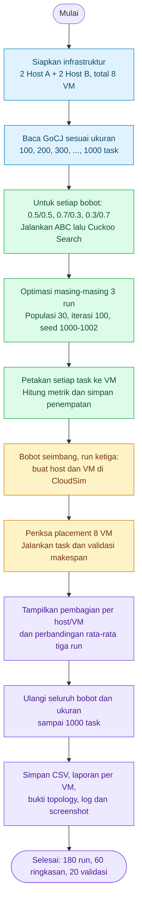

Untuk setiap ukuran dataset, program menguji ketiga bobot. Pada setiap bobot, ABC dijalankan tiga kali kemudian CS tiga kali. Validasi CloudSim hanya memakai mapping run ketiga pada bobot 0.5/0.5, untuk masing-masing algoritma. Detail alur juga tersedia di [ALUR-EKSPERIMEN.md](docs/ALUR-EKSPERIMEN.md).

### 1.5. Persiapan dan cara menjalankan

Buka PowerShell pada repository khusus. Gunakan **`-ImageInfrastructure`** agar host dan MIPS sesuai tabel di atas:

```powershell
cd "C:\Users\TIARA F.A\Kelompok5_SOKA_Metaheuristik"
.\run-metaheuristik.ps1 -ImageInfrastructure -StartTasks 100 -EndTasks 1000 -OutputDirectory experiments/infrastruktur-gambar
```

Script menggunakan JDK 21, Maven, dan settings dari proyek lama `C:\Users\TIARA F.A\soka-taskscheduling1` jika tool lokal tersedia. Pada laptop lain, siapkan JDK 21 dan Maven pada PATH serta dependensi CloudSim 7.0.1 pada repositori Maven lokal. Sediakan sepuluh file dataset sebelum menjalankan.

Untuk menyimpan log sekaligus:

```powershell
New-Item -ItemType Directory -Path experiments/infrastruktur-gambar -Force | Out-Null
.\run-metaheuristik.ps1 -ImageInfrastructure -StartTasks 100 -EndTasks 1000 -OutputDirectory experiments/infrastruktur-gambar 2>&1 |
    Tee-Object -FilePath experiments/infrastruktur-gambar/simulation-output.txt
```

Tanpa `-ImageInfrastructure`, kode memakai profil host seragam sebelumnya. Menjalankan ulang ke folder yang sama menimpa hasil di folder itu. Untuk menyimpan percobaan baru terpisah, ganti `-OutputDirectory`, misalnya `experiments/infrastruktur-gambar-run2`.

## 2. Algoritma ABC, CS, dan rumus metrik

### 2.1. Representasi solusi

Solusi berupa array indeks VM, satu elemen per task. Contoh `mapping = [0, 4, 1]` berarti T1 masuk V0 di H0, T2 masuk V4 di H2, dan T3 masuk V1 di H0. Indeks VM yang sah 0-7. Urutan task pada setiap VM mengikuti urutan dataset.

### 2.2. Artificial Bee Colony

Implementasi: [ABC.java](src/main/java/soka/algo/ABC.java).

1. Bangkitkan 30 food source berupa mapping acak dan hitung fitness.
2. **Employed bees:** buat kandidat menggunakan food source pembanding. Lakukan `max(1, jumlahTask / 10)` percobaan perubahan posisi acak; terima kandidat jika fitness lebih kecil.
3. **Onlooker bees:** pilih food source berdasarkan bobot `fitnessTerburuk - fitnessSaatIni + 1e-9`, lalu lakukan perbaikan kandidat.
4. **Scout bees:** ganti food source secara acak jika penghitung kegagalan melebihi 20.
5. Perbarui arsip solusi terbaik pada akhir iterasi. Setelah 100 iterasi, kembalikan mapping terbaik yang tercatat.

### 2.3. Cuckoo Search

Implementasi: [CuckooSearch.java](src/main/java/soka/algo/CuckooSearch.java).

1. Bangkitkan 30 sarang berisi mapping acak dan hitung fitness.
2. Bentuk kandidat melalui langkah Levy yang dibulatkan untuk indeks VM, dengan beta 1.5 dan sigma 0.6966.
3. Lakukan `max(1, jumlahTask / 10)` percobaan perubahan posisi; bandingkan kandidat dengan sarang acak dan ganti jika lebih baik.
4. Perbarui sarang terburuk sebanyak `round(0.25 x 30) = 8` kali menggunakan selisih dua sarang acak. Sarang terburuk dipilih kembali pada setiap pembaruan sehingga sarang yang sama dapat terpilih lagi.
5. Perbarui arsip solusi terbaik pada akhir iterasi. Setelah 100 iterasi, kembalikan mapping terbaik yang tercatat.

Posisi perubahan dipilih dengan pengembalian; satu task dapat dipilih lebih dari sekali. `Math.floorMod` menjaga indeks VM tetap valid. Populasi dan iterasi yang sama tidak menjamin jumlah evaluasi fitness kedua algoritma sama.

### 2.4. Rumus metrik dan fungsi tujuan

Implementasi: [Metrics.java](src/main/java/soka/Metrics.java).

```text
durasi[i]   = MI[i] / MIPS[mapping[i]]
beban[j]    = jumlah durasi task pada VM j
makespan    = maksimum beban[j]
utilisasi   = total beban / (makespan x jumlahVM) x 100%
waiting[i]  = jumlah durasi task sebelumnya pada VM yang sama
avgWaiting  = rata-rata waiting seluruh task
lowerBound  = total MI / total MIPS VM
fitness     = w1 x (makespan / lowerBound) - w2 x (utilisasi / 100)
```

Fitness diminimalkan untuk bobot yang sama dan dapat bernilai negatif. Waiting time dilaporkan tetapi tidak dimasukkan langsung ke fitness. Waktu dalam hasil adalah **detik model simulasi**, bukan durasi eksekusi program pada laptop. Utilisasi adalah perbandingan waktu sibuk VM, bukan pengukuran CPU hardware.

## 3. Membaca output, validasi, dan hasil

### 3.1. Urutan output dan pembagian task

Output diurutkan **100 -> 200 -> 300 -> 400 -> 500 -> 600 -> 700 -> 800 -> 900 -> 1000 task**. Pada setiap ukuran, terminal menampilkan pembagian ABC dan validasinya, pembagian CS dan validasinya, lalu perbandingan metrik ketiga bobot.

| Kolom | Arti |
|---|---|
| Host / VM | Host H0-H3 dan VM V0-V7 penerima task |
| MIPS | Kapasitas VM: V0-V3 = 500, V4-V7 = 1000 |
| Task | Jumlah task pada antrean VM |
| Beban (s) | Total durasi task pada VM |
| Contoh ID task | Maksimal enam ID pertama, bukan seluruh antrean |

**Pembagian terminal dan screenshot memakai bobot 0.5/0.5, run ketiga, seed 1002.** Tabel metrik bagian bawah memakai rata-rata dan standar deviasi dari tiga run. Maka makespan satu pemetaan dapat berbeda dari makespan rata-rata.

T1 adalah baris pertama dataset. Task mendapat tepat satu VM; total kolom Task seluruh VM harus sama dengan ukuran dataset. Daftar ID lengkap per VM tersedia di [task-distribution/](experiments/infrastruktur-gambar/task-distribution/).

### 3.2. Validasi CloudSim dan bukti MIPS

Validasi memeriksa bahwa seluruh 8 VM berhasil dibuat pada host yang ditentukan, seluruh task selesai, dan selisih makespan CloudSim terhadap analitis tidak melebihi **0.01 detik**. Placement dicatat sebelum task dikirim; [topology-observed.csv](experiments/infrastruktur-gambar/topology-observed.csv) menyimpan bukti dari validasi terakhir. Pemeriksaan placement dilakukan pada seluruh 20 validasi.

Hasil pemeriksaan: H0 dan H1 masing-masing mengalokasikan 500+500 = 1000 MIPS; H2 dan H3 masing-masing mengalokasikan 1000+1000 = 2000 MIPS. Tidak ada host yang melebihi kapasitas MIPS atau RAM.

Eksekusi lengkap yang sudah dijalankan berakhir dengan:

```text
SELESAI: 180 run | 60 ringkasan | 20 validasi CloudSim LULUS
```

### 3.3. File hasil aktif

Semua hasil aktif di bawah berasal dari **satu eksekusi lengkap profil host heterogen**, bukan rekap profil lama:

| File | Isi |
|---|---|
| [results.csv](experiments/infrastruktur-gambar/results.csv) | 180 baris metrik run, di luar header |
| [summary.csv](experiments/infrastruktur-gambar/summary.csv) | 60 ringkasan rata-rata dan standar deviasi sampel, penyebut n-1 |
| [task-assignments.csv](experiments/infrastruktur-gambar/task-assignments.csv) | 99.000 penempatan task lengkap |
| [task-distribution/](experiments/infrastruktur-gambar/task-distribution/) | 20 laporan lengkap per VM, bobot seimbang, run ketiga |
| [topology-observed.csv](experiments/infrastruktur-gambar/topology-observed.csv) | Bukti 8 VM dan host aktual pada validasi terakhir |
| [simulation-output.txt](experiments/infrastruktur-gambar/simulation-output.txt) | Log lengkap dan 20 validasi yang lolos |

CSV penempatan memuat ukuran dataset, algoritma, bobot, run, seed, ID task, MI, host, VM, MIPS, posisi antrean, waktu mulai, durasi, dan waktu selesai model. Waktu antrean relatif awal pekerjaan, bukan timestamp laptop atau event CloudSim mentah.

### 3.4. Hasil perbandingan 100-1000 task

Bobot 0.5/0.5; rata-rata +/- standar deviasi sampel dari tiga run. Makespan dalam detik simulasi.

| Task | ABC makespan (s) | CS makespan (s) |
|---:|---:|---:|
| 100 | 2390.500 +/- 13.892 | 2321.500 +/- 9.579 |
| 200 | 4772.833 +/- 18.373 | 4689.000 +/- 22.153 |
| 300 | 7399.833 +/- 186.117 | 7143.500 +/- 39.395 |
| 400 | 9129.000 +/- 285.930 | 9003.833 +/- 108.307 |
| 500 | 11809.667 +/- 135.799 | 11270.333 +/- 122.001 |
| 600 | 14998.167 +/- 53.020 | 14274.000 +/- 58.198 |
| 700 | 16128.667 +/- 403.992 | 15170.000 +/- 76.099 |
| 800 | 18058.167 +/- 375.437 | 17383.500 +/- 362.649 |
| 900 | 22811.833 +/- 558.428 | 20900.833 +/- 248.088 |
| 1000 | 25058.667 +/- 449.063 | 22655.667 +/- 222.300 |

Pada konfigurasi dan bobot seimbang ini CS memiliki makespan rata-rata lebih rendah di sepuluh ukuran. Tiga pengulangan belum cukup untuk menyatakan keunggulan universal atau signifikansi statistik. Eksperimen tidak membuktikan optimum global dan tidak mengukur durasi komputasi optimizer.

### 3.5. Dokumentasi screenshot 100-1000 task

Sepuluh gambar berikut memakai **foto lokal terbaru**, sesuai kapasitas host dan VM pada bagian 1.2. Urutan setiap foto: pembagian ABC, pembagian CS, lalu perbandingan metrik. Nilai makespan pada keterangan gambar adalah **run ketiga**, bukan rata-rata tiga run pada tabel bagian 3.4.

#### 3.5.1. Simulasi 100 task

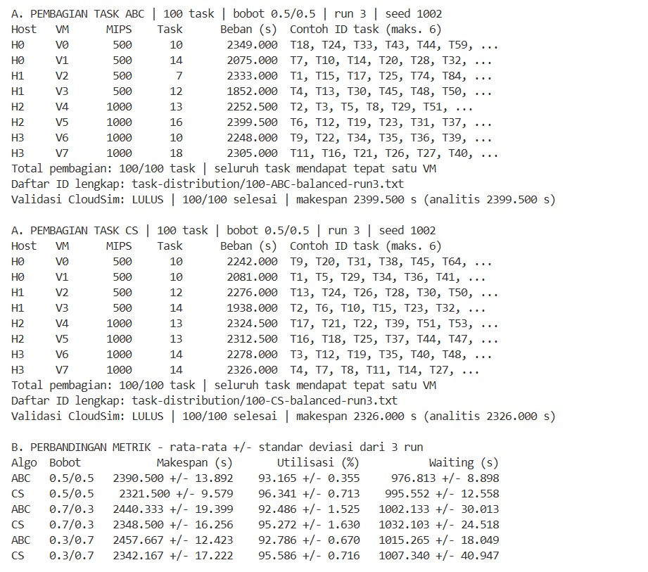

**Gambar 1.** Pembagian 100 task ke 4 host dan 8 VM. ABC dan CS masing-masing menyelesaikan **100/100 task** dan lolos validasi CloudSim. Makespan run ketiga: **ABC 2399.500 s** dan **CS 2326.000 s**.

Daftar ID lengkap: [ABC 100 task](experiments/infrastruktur-gambar/task-distribution/100-ABC-balanced-run3.txt) dan [CS 100 task](experiments/infrastruktur-gambar/task-distribution/100-CS-balanced-run3.txt).

#### 3.5.2. Simulasi 200 task

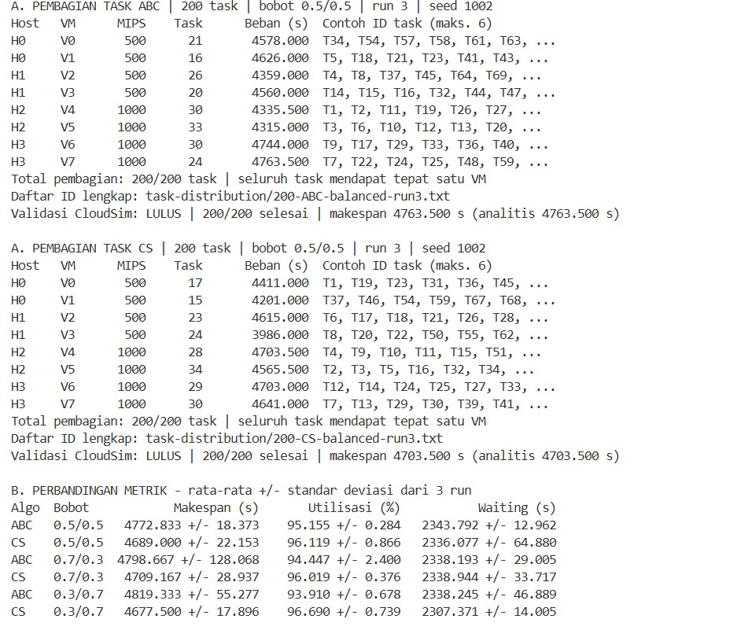

**Gambar 2.** Pembagian 200 task ke 4 host dan 8 VM. ABC dan CS masing-masing menyelesaikan **200/200 task** dan lolos validasi CloudSim. Makespan run ketiga: **ABC 4763.500 s** dan **CS 4703.500 s**.

Daftar ID lengkap: [ABC 200 task](experiments/infrastruktur-gambar/task-distribution/200-ABC-balanced-run3.txt) dan [CS 200 task](experiments/infrastruktur-gambar/task-distribution/200-CS-balanced-run3.txt).

#### 3.5.3. Simulasi 300 task

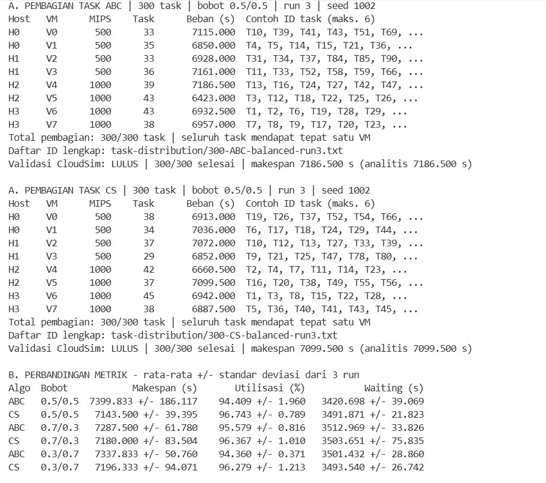

**Gambar 3.** Pembagian 300 task ke 4 host dan 8 VM. ABC dan CS masing-masing menyelesaikan **300/300 task** dan lolos validasi CloudSim. Makespan run ketiga: **ABC 7186.500 s** dan **CS 7099.500 s**.

Daftar ID lengkap: [ABC 300 task](experiments/infrastruktur-gambar/task-distribution/300-ABC-balanced-run3.txt) dan [CS 300 task](experiments/infrastruktur-gambar/task-distribution/300-CS-balanced-run3.txt).

#### 3.5.4. Simulasi 400 task

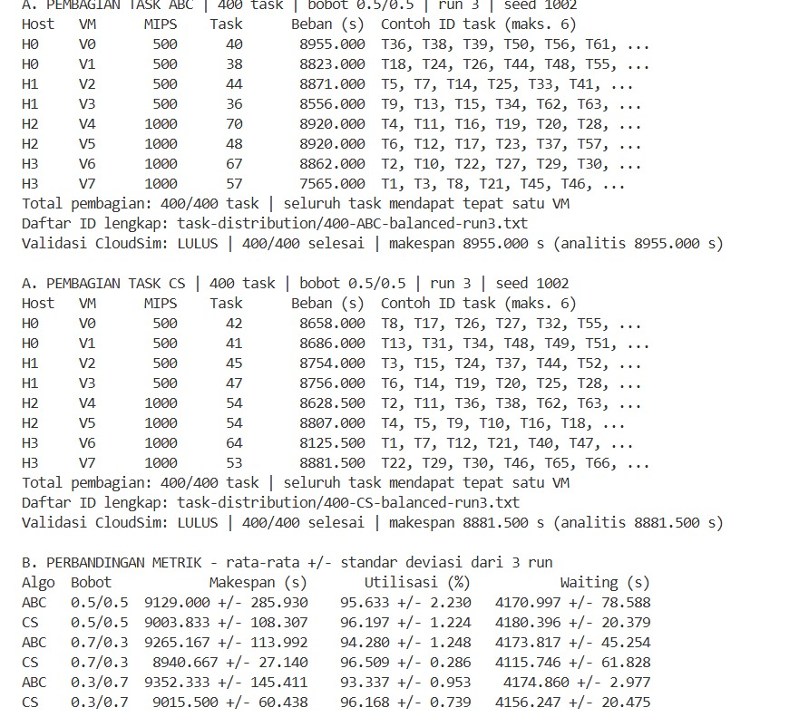

**Gambar 4.** Pembagian 400 task ke 4 host dan 8 VM. ABC dan CS masing-masing menyelesaikan **400/400 task** dan lolos validasi CloudSim. Makespan run ketiga: **ABC 8955.000 s** dan **CS 8881.500 s**.

Daftar ID lengkap: [ABC 400 task](experiments/infrastruktur-gambar/task-distribution/400-ABC-balanced-run3.txt) dan [CS 400 task](experiments/infrastruktur-gambar/task-distribution/400-CS-balanced-run3.txt).

#### 3.5.5. Simulasi 500 task

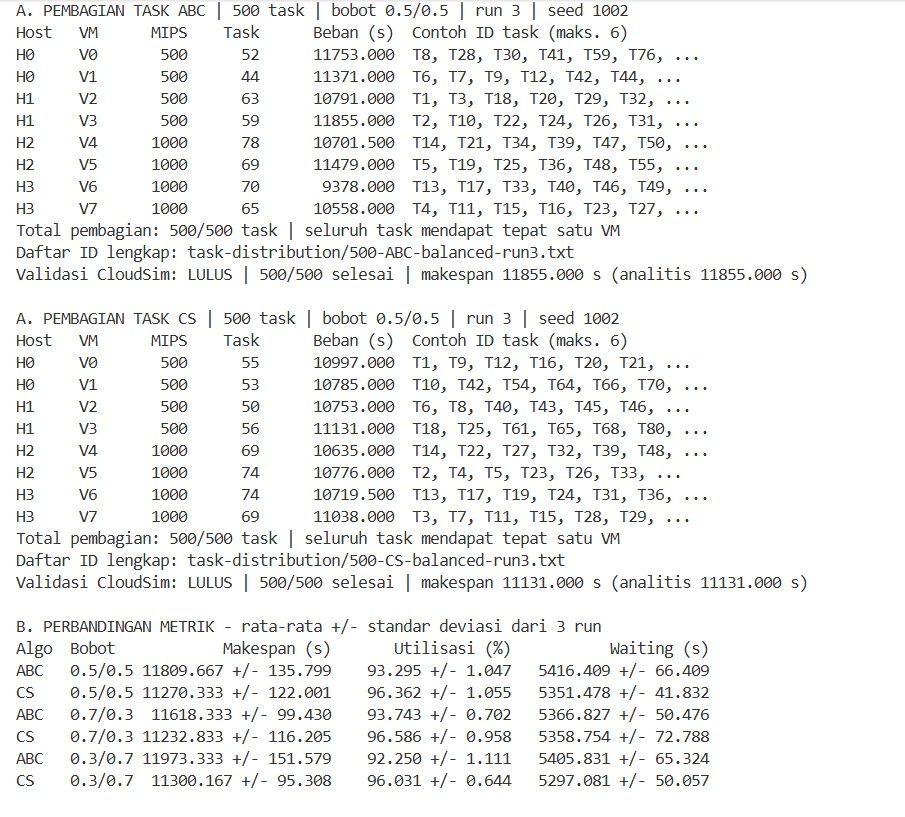

**Gambar 5.** Pembagian 500 task ke 4 host dan 8 VM. ABC dan CS masing-masing menyelesaikan **500/500 task** dan lolos validasi CloudSim. Makespan run ketiga: **ABC 11855.000 s** dan **CS 11131.000 s**.

Daftar ID lengkap: [ABC 500 task](experiments/infrastruktur-gambar/task-distribution/500-ABC-balanced-run3.txt) dan [CS 500 task](experiments/infrastruktur-gambar/task-distribution/500-CS-balanced-run3.txt).

#### 3.5.6. Simulasi 600 task

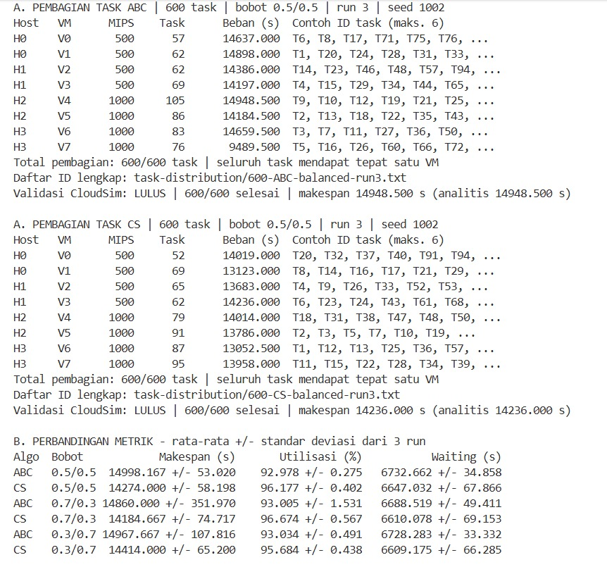

**Gambar 6.** Pembagian 600 task ke 4 host dan 8 VM. ABC dan CS masing-masing menyelesaikan **600/600 task** dan lolos validasi CloudSim. Makespan run ketiga: **ABC 14948.500 s** dan **CS 14236.000 s**.

Daftar ID lengkap: [ABC 600 task](experiments/infrastruktur-gambar/task-distribution/600-ABC-balanced-run3.txt) dan [CS 600 task](experiments/infrastruktur-gambar/task-distribution/600-CS-balanced-run3.txt).

#### 3.5.7. Simulasi 700 task

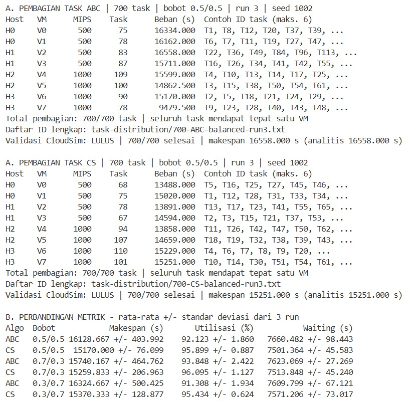

**Gambar 7.** Pembagian 700 task ke 4 host dan 8 VM. ABC dan CS masing-masing menyelesaikan **700/700 task** dan lolos validasi CloudSim. Makespan run ketiga: **ABC 16558.000 s** dan **CS 15251.000 s**.

Daftar ID lengkap: [ABC 700 task](experiments/infrastruktur-gambar/task-distribution/700-ABC-balanced-run3.txt) dan [CS 700 task](experiments/infrastruktur-gambar/task-distribution/700-CS-balanced-run3.txt).

#### 3.5.8. Simulasi 800 task

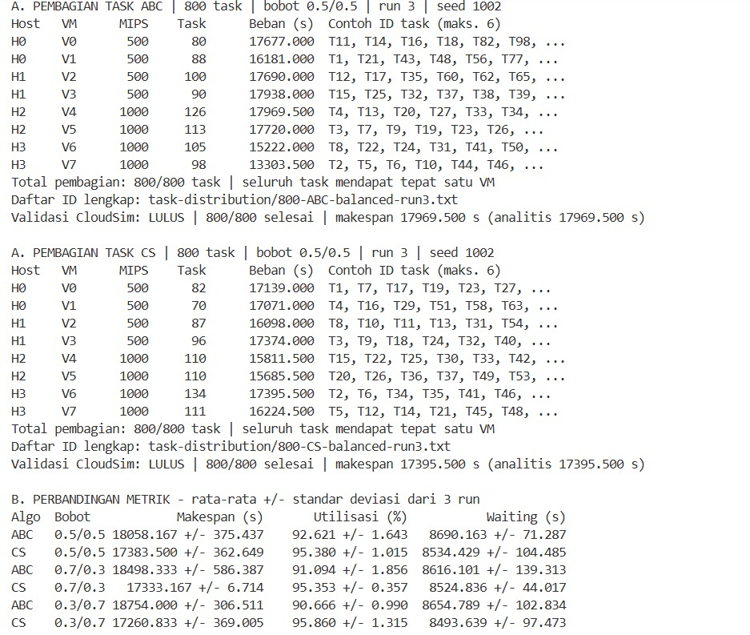

**Gambar 8.** Pembagian 800 task ke 4 host dan 8 VM. ABC dan CS masing-masing menyelesaikan **800/800 task** dan lolos validasi CloudSim. Makespan run ketiga: **ABC 17969.500 s** dan **CS 17395.500 s**.

Daftar ID lengkap: [ABC 800 task](experiments/infrastruktur-gambar/task-distribution/800-ABC-balanced-run3.txt) dan [CS 800 task](experiments/infrastruktur-gambar/task-distribution/800-CS-balanced-run3.txt).

#### 3.5.9. Simulasi 900 task

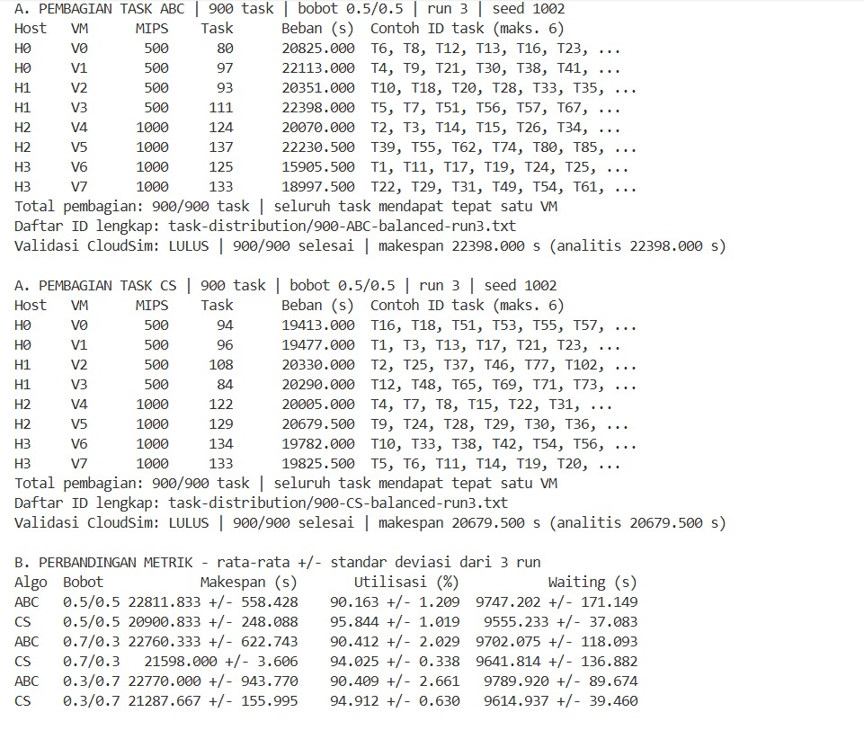

**Gambar 9.** Pembagian 900 task ke 4 host dan 8 VM. ABC dan CS masing-masing menyelesaikan **900/900 task** dan lolos validasi CloudSim. Makespan run ketiga: **ABC 22398.000 s** dan **CS 20679.500 s**.

Daftar ID lengkap: [ABC 900 task](experiments/infrastruktur-gambar/task-distribution/900-ABC-balanced-run3.txt) dan [CS 900 task](experiments/infrastruktur-gambar/task-distribution/900-CS-balanced-run3.txt).

#### 3.5.10. Simulasi 1000 task

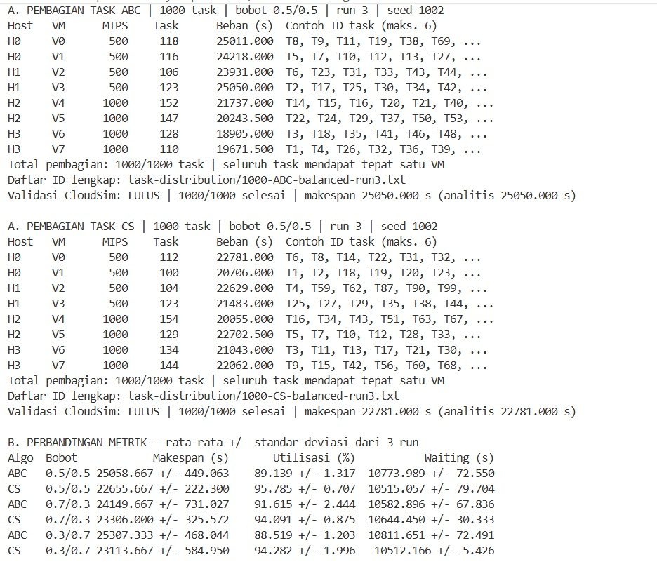

**Gambar 10.** Pembagian 1000 task ke 4 host dan 8 VM. ABC dan CS masing-masing menyelesaikan **1000/1000 task** dan lolos validasi CloudSim. Makespan run ketiga: **ABC 25050.000 s** dan **CS 22781.000 s**.

Daftar ID lengkap: [ABC 1000 task](experiments/infrastruktur-gambar/task-distribution/1000-ABC-balanced-run3.txt) dan [CS 1000 task](experiments/infrastruktur-gambar/task-distribution/1000-CS-balanced-run3.txt).

### 3.6. Kendala dan lokasi kode

Jika Java/Maven tidak ditemukan, periksa tool lokal proyek sebelumnya atau instalasi pada PATH. Jika dependensi tidak ditemukan, pastikan CloudSim 7.0.1 tersedia pada repositori Maven yang digunakan. Jika dataset tidak ditemukan, periksa sepuluh nama file GoCJ dan jalankan script dari repository khusus. Jika MIPS yang tampil berbeda, pastikan opsi **`-ImageInfrastructure`** disertakan. Hentikan penggunaan hasil bila validasi gagal dan periksa log.

Kode eksperimen berada di [Main.java](src/main/java/soka/Main.java); profil infrastruktur dan simulasi di [CloudEnv.java](src/main/java/soka/CloudEnv.java). Algoritma berada di `src/main/java/soka/algo/`.

Hasil serta foto konfigurasi lama tetap disimpan terpisah. File hasil di root dan `experiments/100-1000/` berasal dari profil sebelumnya; dokumentasi aktif README ini mengacu pada **`experiments/infrastruktur-gambar/`**. Foto WhatsApp asli tetap disimpan pada folder lokal paket.
