# Alur eksperimen 100-1000 task

ABC dan CS: 1 datacenter, 4 host, 8 VM; populasi 30, 100 iterasi; tiga bobot dan tiga seed 1000-1002.

```mermaid
flowchart TD
    START([Mulai eksperimen]) --> CONFIG["1. Siapkan konfigurasi cloud<br/>1 datacenter - 4 host - 8 VM"]
    CONFIG --> DATA["2. Baca dataset GoCJ<br/>100, 200, 300, ..., 1000 task"]
    DATA --> SETUP["3. Untuk setiap ukuran dataset<br/>Uji bobot 0.5/0.5, 0.7/0.3, 0.3/0.7"]
    SETUP --> ABC["4. Jalankan Artificial Bee Colony<br/>3 run - seed 1000, 1001, 1002"]
    ABC --> ABCMAP["Pemetaan ABC: task ke VM, VM pada host<br/>Hitung metrik dan simpan penempatan"]
    ABCMAP --> ABCVAL["Validasi ABC di CloudSim<br/>Hanya bobot 0.5/0.5, run ketiga"]
    ABCVAL --> CS["5. Jalankan Cuckoo Search<br/>3 run - seed 1000, 1001, 1002"]
    CS --> CSMAP["Pemetaan CS: task ke VM, VM pada host<br/>Hitung metrik dan simpan penempatan"]
    CSMAP --> CSVAL["Validasi CS di CloudSim<br/>Hanya bobot 0.5/0.5, run ketiga"]
    CSVAL --> REPEAT["6. Lanjutkan bobot dan ukuran berikutnya<br/>Urutan ukuran: 100 sampai 1000, kenaikan 100"]
    REPEAT --> OUTPUT["7. Bandingkan ABC dan CS<br/>Makespan - Utilisasi - Waiting time"]
    OUTPUT --> FILES["8. Simpan hasil dan dokumentasi<br/>CSV - pembagian per VM - log - screenshot"]
    FILES --> END([Rekap: 180 run - 60 ringkasan - 20 validasi])

    classDef startEnd fill:#0f172a,color:#ffffff,stroke:#0f172a;
    classDef setup fill:#e0f2fe,color:#0c4a6e,stroke:#0284c7;
    classDef abc fill:#dcfce7,color:#14532d,stroke:#16a34a;
    classDef cs fill:#fef3c7,color:#78350f,stroke:#d97706;
    classDef output fill:#ede9fe,color:#4c1d95,stroke:#7c3aed;
    class START,END startEnd;
    class CONFIG,DATA,SETUP setup;
    class ABC,ABCMAP,ABCVAL abc;
    class CS,CSMAP,CSVAL cs;
    class REPEAT,OUTPUT,FILES output;
```

Untuk setiap ukuran 100, 200, hingga 1000, uji tiga bobot. Pada setiap bobot jalankan ABC lalu CS, masing-masing tiga run. Simpan pemetaan dan metrik; validasi mapping run ketiga pada bobot seimbang dengan CloudSim. Susun sepuluh screenshot menurut jumlah task.

Hasil berasal dari tahap 100-500 dan lanjutan 500-1000. Rekap memakai 100-400 dari awal dan 500-1000 dari lanjutan, tanpa duplikasi 500: 180 run, 60 ringkasan, 20 validasi terpilih, 99.000 penempatan dan 20 laporan per VM. Ini penggabungan dua eksekusi, bukan satu eksekusi baru. Rekap berada di `experiments/100-1000/`; bukti log ada di root dan `experiments/500-1000/`.
