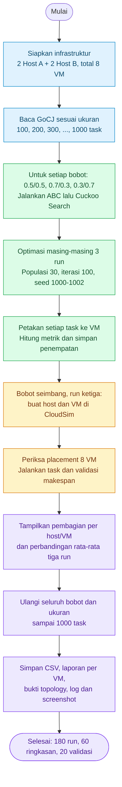

# Alur eksperimen host heterogen 100-1000 task

Profil aktif: 1 datacenter, 2 Host A (1 PE x 1000 MIPS, RAM 2048 MB), 2 Host B (1 PE x 2000 MIPS, RAM 4096 MB). H0/H1 masing-masing dua VM 500 MIPS; H2/H3 masing-masing dua VM 1000 MIPS. Total 6000 MIPS.

1. Baca GoCJ sesuai ukuran 100, 200, hingga 1000.
2. Untuk setiap ukuran, uji bobot 0.5/0.5, 0.7/0.3, 0.3/0.7.
3. Pada setiap bobot, jalankan ABC lalu CS, masing-masing tiga run, populasi 30 dan iterasi 100.
4. Catat pemetaan dan metrik setiap run; hitung ringkasan tiga run.
5. Run ketiga pada bobot seimbang divalidasi di CloudSim, termasuk placement VM, jumlah task selesai, dan toleransi makespan 0.01 detik.
6. Simpan hasil di `experiments/infrastruktur-gambar/`, kemudian dokumentasikan sepuluh ukuran secara berurutan.

Hasil eksekusi aktif: 180 run, 60 ringkasan, 20 validasi lolos, 99.000 penempatan task, dan 20 laporan per VM. Hasil ini berasal dari satu eksekusi profil host heterogen. Foto terbaru pada README utama sesuai dengan hasil tersebut.
