## Alur eksperimen simulasi cloud task scheduling

Eksperimen menjalankan dua metaheuristik mandiri, **ABC dan Cuckoo Search**, pada topologi yang sama: **1 datacenter, 4 host, 8 VM**. Dataset memasok panjang task; konfigurasi datacenter memasok sumber daya pemrosesannya.

```mermaid
flowchart TD
    START([Mulai eksperimen]) --> CONFIG["1. Siapkan konfigurasi cloud<br/>1 datacenter - 4 host - 8 VM"]
    CONFIG --> DATA["2. Baca dataset GoCJ<br/>100 ? 200 ? 300 ? 400 ? 500 task"]
    DATA --> SETUP["3. Untuk setiap ukuran dataset<br/>Uji bobot 0.5/0.5, 0.7/0.3, 0.3/0.7"]
    SETUP --> ABC["4. Jalankan Artificial Bee Colony<br/>3 run - seed 1000, 1001, 1002"]
    ABC --> ABCMAP["Pemetaan ABC: task ? VM ? host<br/>Hitung metrik dan simpan penempatan"]
    ABCMAP --> ABCVAL["Validasi ABC di CloudSim<br/>Hanya bobot 0.5/0.5, run ketiga"]
    ABCVAL --> CS["5. Jalankan Cuckoo Search<br/>3 run - seed 1000, 1001, 1002"]
    CS --> CSMAP["Pemetaan CS: task ? VM ? host<br/>Hitung metrik dan simpan penempatan"]
    CSMAP --> CSVAL["Validasi CS di CloudSim<br/>Hanya bobot 0.5/0.5, run ketiga"]
    CSVAL --> REPEAT["6. Lanjutkan bobot dan ukuran berikutnya<br/>Urutan ukuran: 100, 200, 300, 400, 500"]
    REPEAT --> OUTPUT["7. Bandingkan ABC dan CS<br/>Makespan - Utilisasi - Waiting time"]
    OUTPUT --> FILES["8. Simpan hasil dan dokumentasi<br/>CSV - pembagian per VM - log - screenshot"]
    FILES --> END([Selesai: 90 run - 30 ringkasan - 10 validasi])

    classDef startEnd fill:#0f172a,color:#ffffff,stroke:#0f172a;
    classDef setup fill:#e0f2fe,color:#0c4a6e,stroke:#0284c7;
    classDef abc fill:#dcfce7,color:#14532d,stroke:#16a34a;
    classDef cs fill:#fef3c7,color:#78350f,stroke:#d97706;
    classDef output fill:#ede9fe,color:#4c1d95,stroke:#7c3aed;
    class START,END startEnd;
    class CONFIG,DATA,SETUP setup;
    class ABC,ABCMAP,ABCVAL abc;
    class CS,CSMAP,CSVAL cs;
    class REPEAT,OUTPUT,FILES output;
```

### Urutan pelaksanaan

1. **Siapkan sumber daya.** `CloudEnv.java` menyediakan spesifikasi host dan VM. Setiap host memiliki satu VM 500 MIPS dan satu VM 1000 MIPS. Lingkungan CloudSim dibuat ketika validasi dijalankan.
2. **Baca beban kerja.** Mulai dari `GoCJ_Dataset_100.txt`, kemudian 200, 300, 400, dan 500. Satu baris menjadi satu task; jumlah baris harus cocok dengan ukuran eksperimen.
3. **Tentukan bobot.** Uji pasangan makespan/utilisasi 0.5/0.5, 0.7/0.3, lalu 0.3/0.7. Kedua algoritma memakai dataset dan kapasitas VM yang sama.
4. **Optimasi menggunakan ABC dan CS.** Untuk setiap pasangan bobot, jalankan ABC lalu CS, masing-masing tiga kali. Setiap run memakai populasi 30, 100 iterasi, dan seed 1000, 1001, atau 1002. Solusi menyatakan VM penerima setiap task.
5. **Bentuk antrean VM.** Task yang masuk VM yang sama mengikuti urutan dataset. Hitung durasi dari MI/MIPS dan catat posisi antrean serta waktu mulai/selesai model.
6. **Hitung dan simpan metrik.** Simpan makespan, utilisasi, waiting time, dan fitness setiap run ke `results.csv`; seluruh penempatan task ke `task-assignments.csv`. Setelah tiga run, simpan rata-rata dan standar deviasi ke `summary.csv`.
7. **Validasi pemetaan terpilih.** Pada bobot 0.5/0.5, ambil mapping run ketiga dan jalankan cloudlet di CloudSim. Jumlah cloudlet selesai harus sesuai jumlah task; selisih makespan CloudSim dan analitis maksimal 0.01 detik. Ketidaksesuaian menghentikan program.
8. **Tampilkan pembagian dan perbandingan.** Tabel host/VM menunjukkan mapping run ketiga pada bobot seimbang. Laporan `task-distribution/` menyimpan ID task lengkap. Tabel metrik membandingkan rata-rata tiga run pada semua bobot.
9. **Dokumentasikan hasil.** Susun screenshot 100, 200, 300, 400, 500 task, lalu sertakan log dan CSV dari run yang sama.

### Jumlah keluaran yang diharapkan

| Keluaran | Perhitungan | Jumlah |
|---|---|---:|
| Run | 5 ukuran x 3 bobot x 2 algoritma x 3 pengulangan | 90 |
| Ringkasan | 5 ukuran x 3 bobot x 2 algoritma | 30 |
| Validasi CloudSim | 5 ukuran x 2 algoritma; bobot seimbang, run ketiga | 10 |
| Penempatan task individual | (100+200+300+400+500) x 3 bobot x 2 algoritma x 3 run | 27.000 |
| Laporan pembagian per VM | 5 ukuran x 2 algoritma; bobot seimbang, run ketiga | 10 |

Pencarian solusi dan metrik seluruh run dihitung oleh kode Java. CloudSim memvalidasi pemetaan terpilih, bukan menjalankan ulang seluruh 90 run. Waktu hasil adalah waktu model simulasi, bukan lama program berjalan pada laptop.
