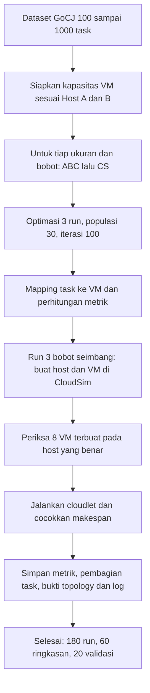

# Eksperimen sesuai gambar: host heterogen

Eksekusi ini memakai infrastruktur gambar pengguna dan hanya dua metaheuristik: **Artificial Bee Colony (ABC)** dan **Cuckoo Search (CS)**. Eksekusi lengkap 100-1000 selesai dengan **180 run, 60 ringkasan, dan 20 validasi CloudSim lolos**.

## 1. Infrastruktur yang dijalankan

| Host | Tipe | PE | MIPS per PE | RAM (MB) | Bandwidth | VM yang ditempatkan |
|---|---|---:|---:|---:|---:|---|
| H0 | A | 1 | 1000 | 2048 | 10000 | V0 dan V1: masing-masing 500 MIPS, RAM 512 MB |
| H1 | A | 1 | 1000 | 2048 | 10000 | V2 dan V3: masing-masing 500 MIPS, RAM 512 MB |
| H2 | B | 1 | 2000 | 4096 | 10000 | V4 dan V5: masing-masing 1000 MIPS, RAM 1024 MB |
| H3 | B | 1 | 2000 | 4096 | 10000 | V6 dan V7: masing-masing 1000 MIPS, RAM 1024 MB |

Total: 1 datacenter, 4 host heterogen, 4 VM kecil dan 4 VM besar. Setiap VM memiliki 1 PE dan BW 1000. Penempatan dua VM kecil pada Host A dan dua VM besar pada Host B menjaga total permintaan MIPS sesuai kapasitas host. Satu VM kecil ditambah satu VM besar memerlukan 1500 MIPS sehingga tidak muat pada Host A 1000 MIPS.

Penempatan ini diperiksa ketika VM benar-benar dibuat di CloudSim, sebelum cloudlet dikirim. Bukti dari simulasi terakhir tersimpan di [topology-observed.csv](topology-observed.csv). Pemeriksaan jumlah VM dan host penerima dilakukan pada seluruh 20 validasi.

Scheduler host adalah `VmSchedulerTimeShared`; scheduler cloudlet adalah `CloudletSchedulerSpaceShared`. Task independen, tersedia sejak awal, non-preemptive. Setiap task dipetakan ke satu VM; satu VM boleh menerima banyak task dalam antrean.

## 2. Protokol

- Task: 100, 200, 300, 400, 500, 600, 700, 800, 900, 1000.
- Algoritma: ABC dan CS; populasi 30, 100 iterasi.
- Bobot makespan/utilisasi: 0.5/0.5, 0.7/0.3, 0.3/0.7.
- Tiga run, seed 1000, 1001, 1002.
- 10 ukuran x 2 algoritma x 3 bobot x 3 run = 180 run, 60 ringkasan.
- 20 validasi: run ketiga, bobot seimbang, setiap ukuran dan algoritma.

Angka 450 run, 150 ringkasan, 50 validasi dan perbandingan Round Robin pada slide mencakup eksperimen lima algoritma. Eksekusi ini tetap khusus ABC dan CS sesuai lingkup tugas metaheuristik.

## 3. Menjalankan ulang

Dari PowerShell di root repository:

```powershell
.\run-metaheuristik.ps1 -ImageInfrastructure -StartTasks 100 -EndTasks 1000 -OutputDirectory experiments/infrastruktur-gambar
```

Untuk menyimpan log sekaligus:

```powershell
.\run-metaheuristik.ps1 -ImageInfrastructure -StartTasks 100 -EndTasks 1000 -OutputDirectory experiments/infrastruktur-gambar 2>&1 |
    Tee-Object experiments/infrastruktur-gambar/simulation-output.txt
```

Folder ini sudah tersedia. Menjalankan ulang ke folder sama menimpa hasilnya. Tanpa `-ImageInfrastructure`, kode tetap menggunakan profil host seragam sebelumnya.

## 4. Alur simulasi



## 5. Hasil makespan

Bobot seimbang 0.5/0.5; rata-rata +/- standar deviasi sampel dari tiga run. Waktu dalam detik model simulasi, bukan lama program dijalankan.

| Task | ABC makespan (s) | CS makespan (s) |
|---:|---:|---:|
| 100 | 2390.500 +/- 13.892 | 2321.500 +/- 9.579 |
| 200 | 4772.833 +/- 18.373 | 4689.000 +/- 22.153 |
| 300 | 7399.833 +/- 186.117 | 7143.500 +/- 39.395 |
| 400 | 9129.000 +/- 285.930 | 9003.833 +/- 108.307 |
| 500 | 11809.667 +/- 135.799 | 11270.333 +/- 122.001 |
| 600 | 14998.167 +/- 53.020 | 14274.000 +/- 58.198 |
| 700 | 16128.667 +/- 403.992 | 15170.000 +/- 76.099 |
| 800 | 18058.167 +/- 375.437 | 17383.500 +/- 362.649 |
| 900 | 22811.833 +/- 558.428 | 20900.833 +/- 248.088 |
| 1000 | 25058.667 +/- 449.063 | 22655.667 +/- 222.300 |


## 6. File hasil dan dokumentasi

| File | Isi |
|---|---|
| [results.csv](results.csv) | 180 run |
| [summary.csv](summary.csv) | 60 ringkasan |
| [task-assignments.csv](task-assignments.csv) | 99.000 penempatan task |
| [task-distribution/](task-distribution/) | 20 pemetaan lengkap per VM, run ketiga bobot seimbang |
| [topology-observed.csv](topology-observed.csv) | Delapan VM dan host aktual pada validasi terakhir |
| [simulation-output.txt](simulation-output.txt) | Log lengkap termasuk 20 validasi yang lolos |

Untuk dokumentasi baru, ambil screenshot konfigurasi awal, lalu pembagian ABC/CS dan metrik setiap ukuran secara berurutan. File output berikut merupakan cuplikan teks hasil asli yang bisa dibuka untuk dokumentasi:

- [Output 100 task](output-100-task.txt).
- [Output 200 task](output-200-task.txt).
- [Output 300 task](output-300-task.txt).
- [Output 400 task](output-400-task.txt).
- [Output 500 task](output-500-task.txt).
- [Output 600 task](output-600-task.txt).
- [Output 700 task](output-700-task.txt).
- [Output 800 task](output-800-task.txt).
- [Output 900 task](output-900-task.txt).
- [Output 1000 task](output-1000-task.txt).

Screenshot lama pada README utama memakai profil host seragam dan urutan kapasitas VM yang berbeda. Foto tersebut tetap disimpan sebagai dokumentasi sebelumnya; belum ada screenshot baru yang dilampirkan untuk profil host heterogen ini. Hasil baru tidak digabung dengan rekap profil lama.
